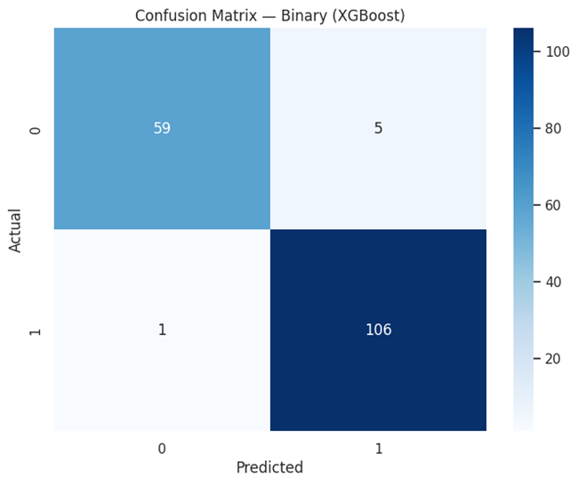
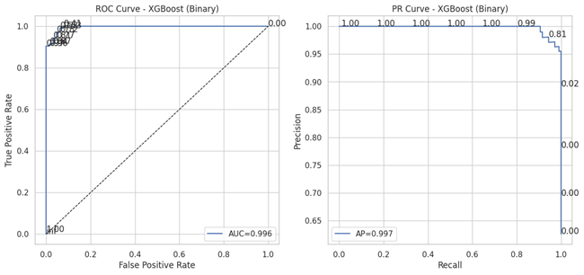
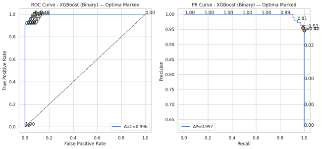
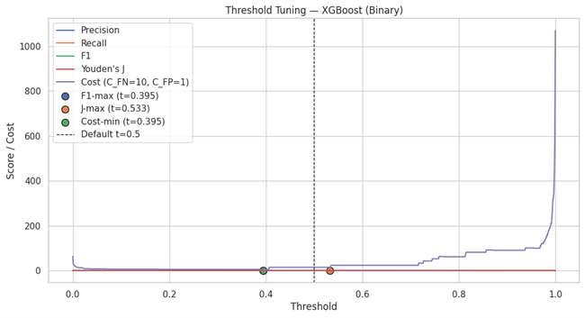
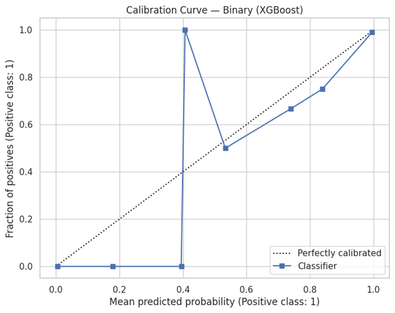
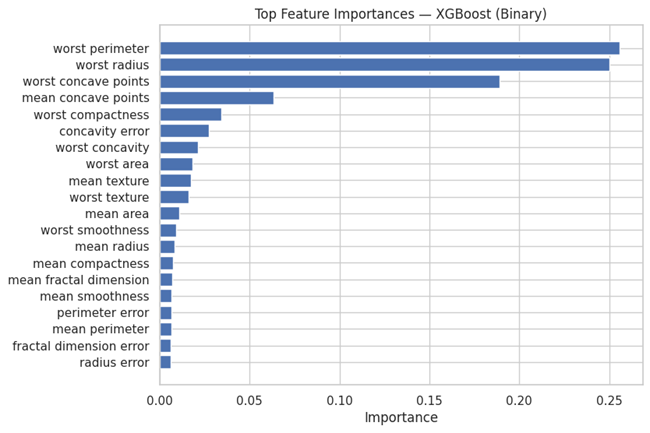
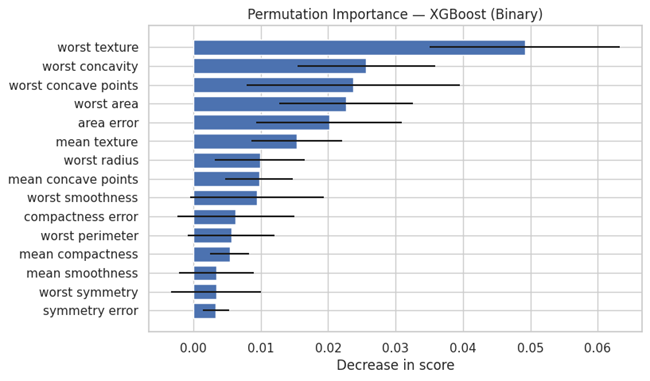
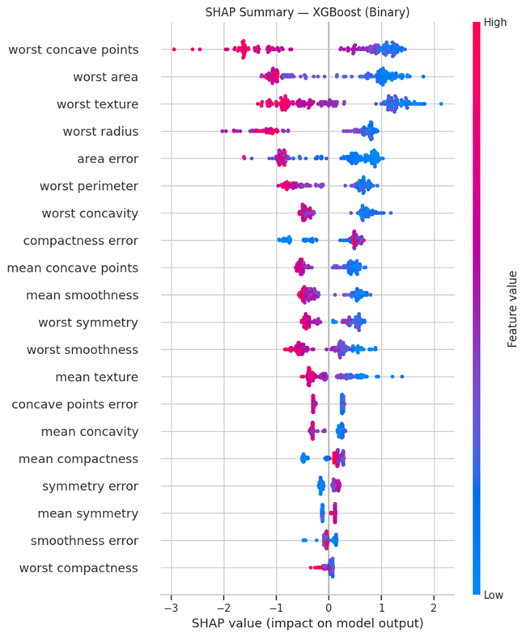

# ⚡ Gradient Boosting — XGBoost · LightGBM · CatBoost

This project compares **three gradient boosting algorithms** — **XGBoost**, **LightGBM**, and **CatBoost** — across  
1️⃣ Binary classification (Breast Cancer)  
2️⃣ Multiclass classification (Iris)  
3️⃣ Multilabel classification (Synthetic dataset)

It demonstrates complete model evaluation with **ROC/PR curves**, **threshold tuning**, **feature importances**, and **SHAP explainability**.

---

## 🚀 Key Highlights
- End-to-end benchmarking of XGBoost, LightGBM, and CatBoost  
- Supports Binary, Multiclass, and Multilabel tasks  
- Includes 5-Fold CV metrics, ROC/PR visualizations, and calibration  
- Automatic threshold tuning for F1-max, Youden’s J, and Cost-min  
- Model interpretability via **Permutation Importance** and **SHAP values**

---

## 📊 Binary Classification (Breast Cancer Dataset)

| Metric | Mean ± SD (5-Fold CV) |
|:-------|:---------------------:|
| Accuracy | 0.963 ± 0.010 |
| Precision | 0.968 ± 0.022 |
| Recall | 0.975 ± 0.022 |
| F1 | 0.971 ± 0.008 |
| ROC AUC | 0.994 ± 0.005 |
| Log Loss | −0.098 ± 0.031 |

✅ **Best Threshold (F1-max):** 0.395 → F1 = 0.977 | J = 0.922 | Cost = 5  

---

## 📈 Evaluation Visuals — Binary
  
  
  
  
  
  
  

---

## 🌈 Multiclass Classification (Iris Dataset)

| Metric | Mean ± SD (5-Fold CV) |
|:-------|:---------------------:|
| Accuracy | 0.953 ± 0.034 |
| F1 Macro | 0.953 ± 0.034 |
| F1 Micro | 0.953 ± 0.034 |
| Log Loss | −1.682 ± 1.225 |

  
  
  

---

## 🧩 Multilabel Classification (Synthetic Dataset)

| Metric | Value |
|:-------|:------:|
| Subset Accuracy | 0.18 |
| Hamming Loss | 0.280 |
| Jaccard (Micro) | 0.413 |

  

---

## 💡 Insights
- **XGBoost** provides highest recall & calibration stability.  
- **LightGBM** achieves superior speed and slightly lower log loss.  
- **CatBoost** performs well with imbalanced and categorical data.  
- SHAP values highlight **mean radius**, **worst area**, and **worst texture** as most influential in Breast Cancer dataset.

---

## 🔮 Future Enhancements
- Integrate **ensemble voting** among boosting models  
- Implement **Bayesian Optimization** for auto-tuning  
- Add **cross-dataset generalization study**  
- Extend SHAP to **multilabel visualization**

---

## 👨‍💻 Author
**Shubham Singh**

---

## 📜 License
MIT License

