# ⚡ Gradient Boosting — XGBoost · LightGBM · CatBoost (Binary & Multiclass Classification)

This project showcases **Gradient Boosted Models (GBMs)** — including **XGBoost**, **LightGBM**, and **CatBoost** — for both **binary** and **multiclass** classification problems.

It includes complete evaluation pipelines: cross-validation, ROC/PR curves, confusion matrices, calibration, and interpretability using **SHAP** and **Permutation Importance**.

---

## 🚀 Key Highlights
- Implemented and compared **XGBoost**, **LightGBM**, and **CatBoost**
- Covers both **Binary** and **Multiclass** classification tasks
- 5-Fold CV with metrics: Accuracy, Precision, Recall, F1, ROC-AUC
- **Threshold tuning** and **probability calibration**
- **Feature importance** & **SHAP explainability**
- GPU acceleration enabled (`tree_method='gpu_hist'`, `device='gpu'`)

---

## 📊 Binary Classification Results

### Confusion Matrices

---

### ROC & PR Curves
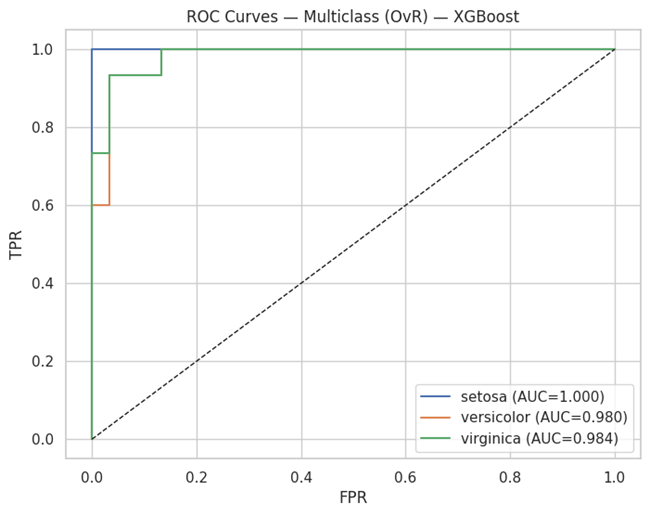
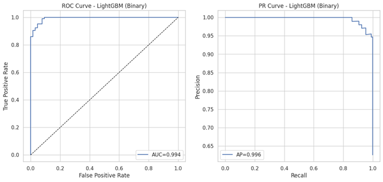

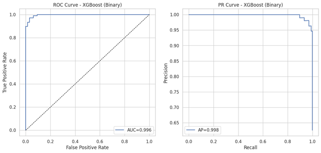

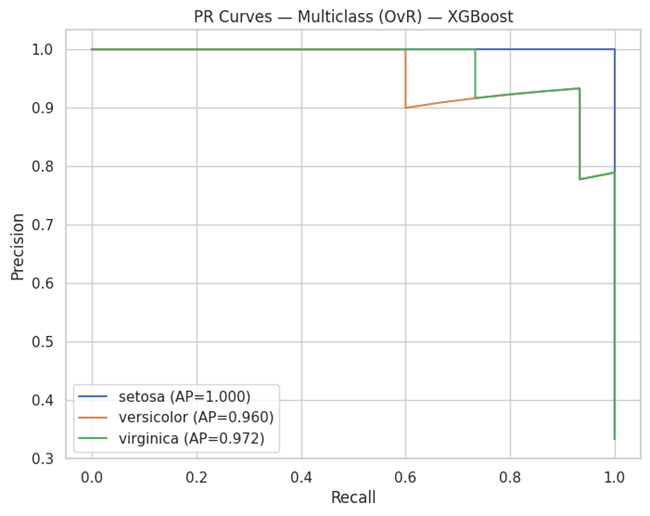
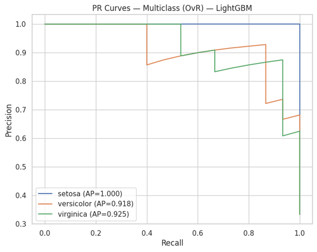
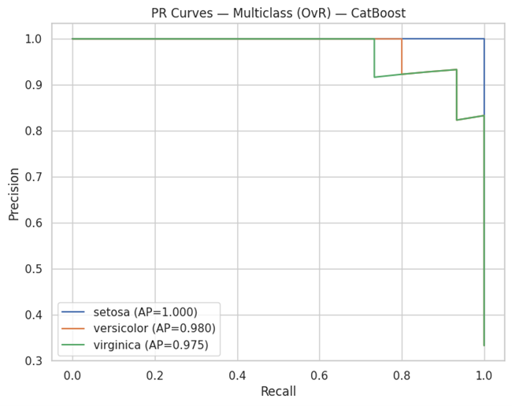

---

### Calibration Curves
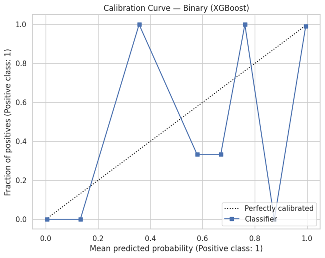
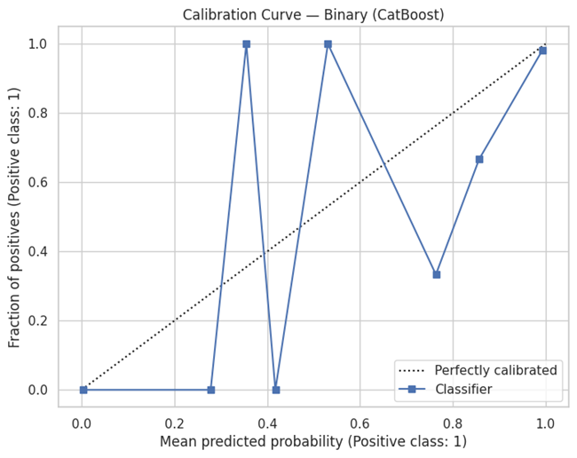
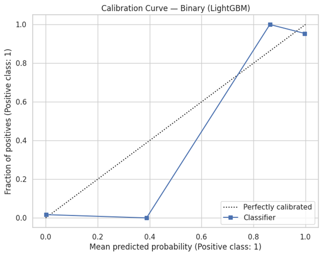

---

## 🌈 Multiclass Classification Results

### Confusion Matrices

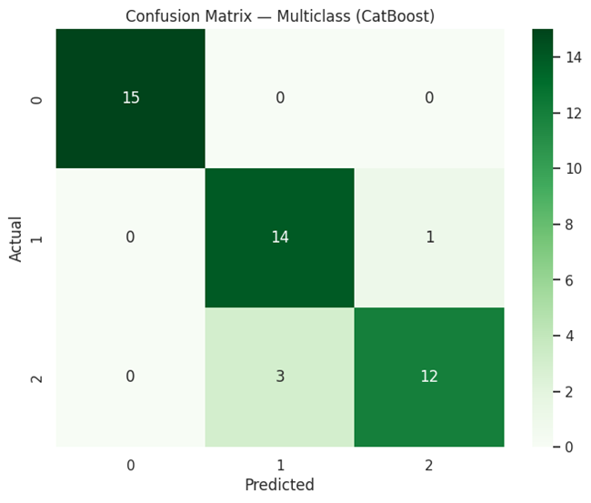
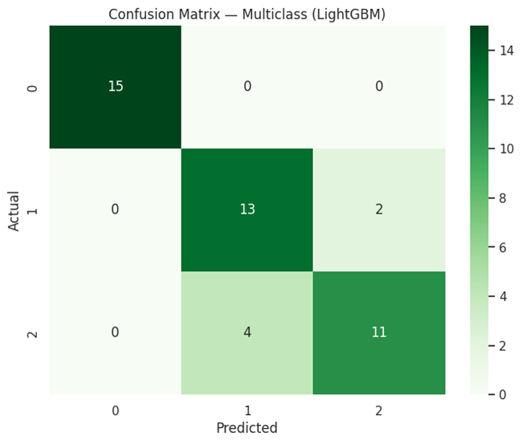

---

### ROC & PR Curves (Multiclass)

---

## 💡 Insights
- **XGBoost** performs best in recall and ROC-AUC.
- **LightGBM** provides faster convergence on GPU.
- **CatBoost** handles categorical features smoothly with strong calibration.
- Model performance remains consistent across folds.

---

## 🧩 Future Enhancements
- Add **Optuna tuning** for automated hyperparameter search  
- Integrate **SHAP interaction values** for feature synergy analysis  
- Add **ensemble stacking** combining XGBoost + CatBoost  

---

## ⚙️ Dependencies
Refer to `requirements.txt` for all dependencies.

---

## 👨‍💻 Author
**Shubham Singh**

---

## 📜 License
MIT License

