# 🤖 K-Nearest Neighbors (KNN) — Binary, Multiclass & Multilabel Classification

The **K-Nearest Neighbors (KNN)** algorithm is a non-parametric method used for classification and regression.  
This project demonstrates its application on **Binary**, **Multiclass**, and **Multilabel** datasets with full model evaluation and visualization.

---

## 🚀 Key Features
✅ Binary classification using the **Breast Cancer Dataset**  
✅ Multiclass classification using the **Iris Dataset**  
✅ Multilabel classification using a **synthetic dataset**  
✅ Includes **ROC/PR curves**, **Calibration curves**, **Threshold tuning**, and **Confusion matrices**  
✅ Visual performance analysis through **k-vs-error** and **subset accuracy** plots  

---

## 📊 Binary Classification (Breast Cancer Dataset)

### Confusion Matrix  
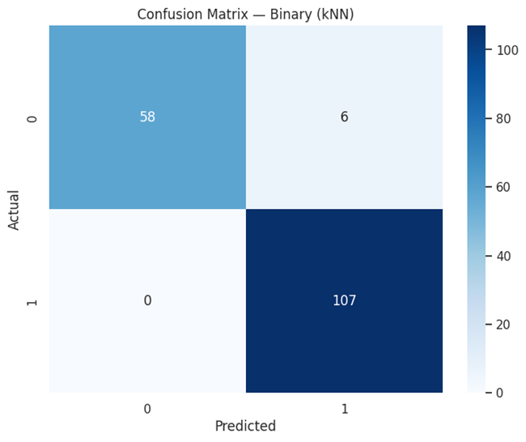

### ROC & PR Curves  
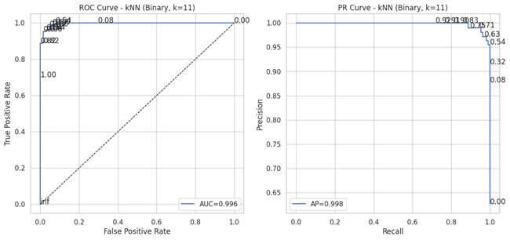  
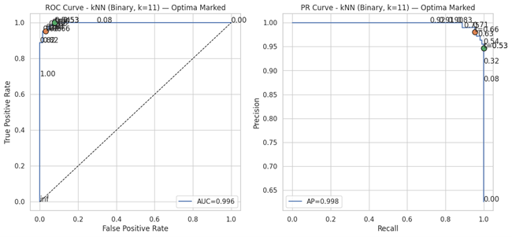

### Threshold Tuning  
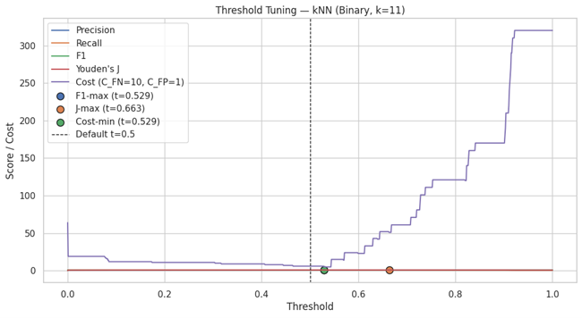

### Calibration Curve  
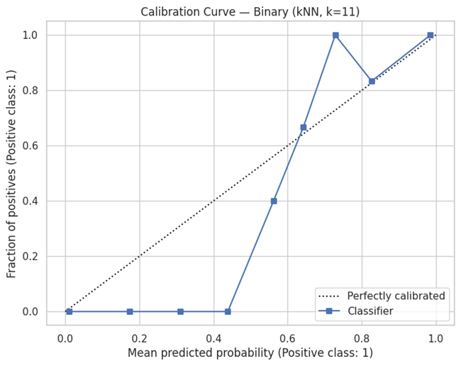

### k-vs-Error Curve  
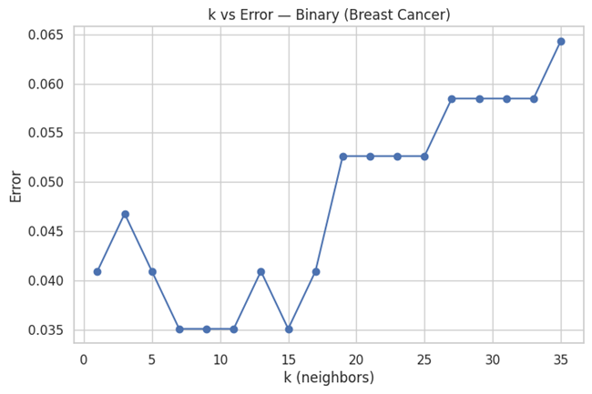

---

## 🌈 Multiclass Classification (Iris Dataset)

### Confusion Matrix  
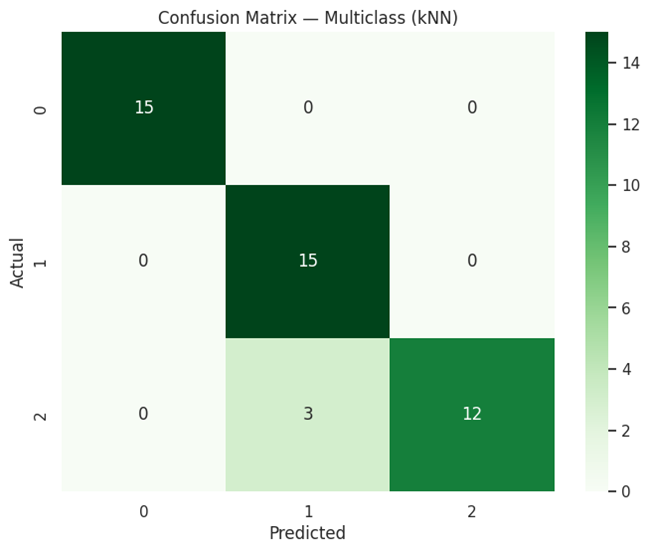

### ROC & PR Curves  
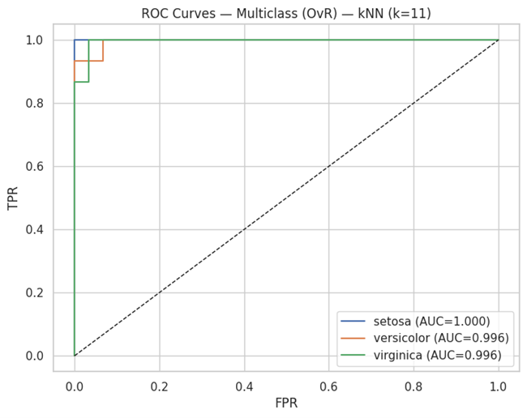  
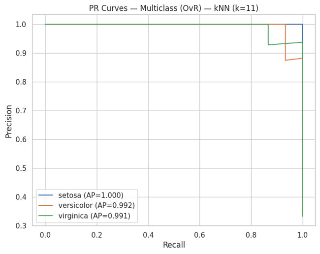

### Calibration Curve  

---

## 🔢 Multilabel Classification (Synthetic Dataset)

### Confusion Matrix (Label 0)  
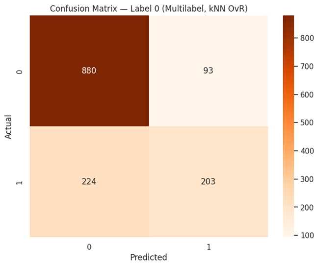

### ROC Curves  
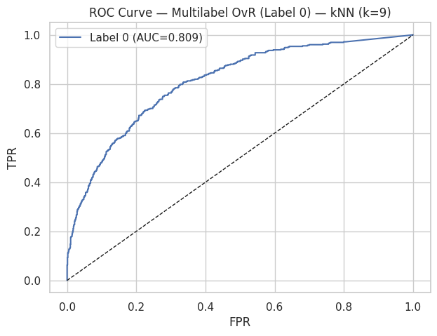  
  

### PR Curves  
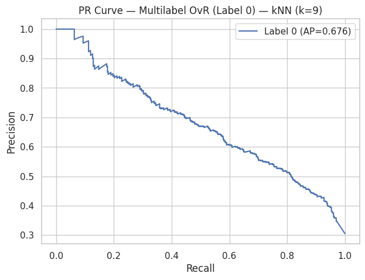  
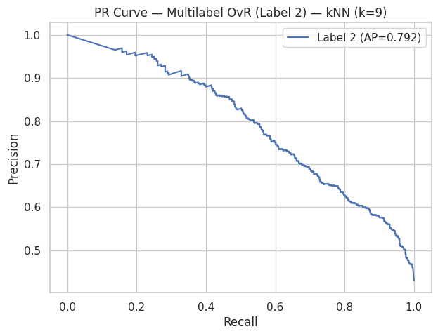

### Subset Accuracy  
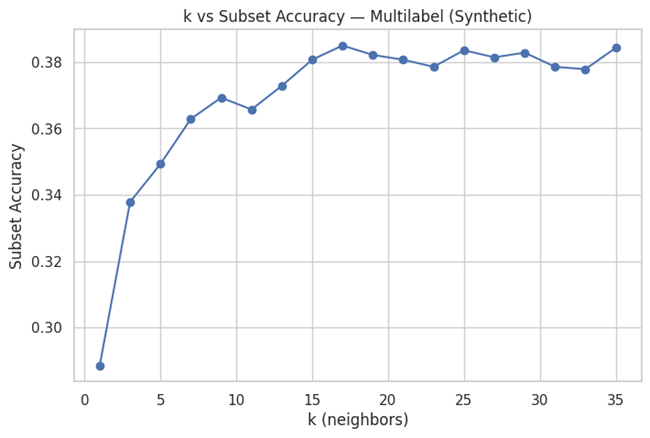

---

## 💡 Insights
- **KNN** provides interpretable decision boundaries without explicit training.  
- **Binary**: High recall with optimized thresholds.  
- **Multiclass**: Excellent separation among classes.  
- **Multilabel**: Balanced precision and recall across correlated outputs.  

---

## 🔮 Future Enhancements
- Add **distance weighting** (uniform vs distance) analysis  
- Compare **KNN vs SVM** for similar datasets  
- Extend to **regression tasks**  
- Implement **KD-Tree / Ball-Tree acceleration** for scalability  

---

## 👨‍💻 Author
**Shubham Singh**

---

## 📜 License
MIT License
