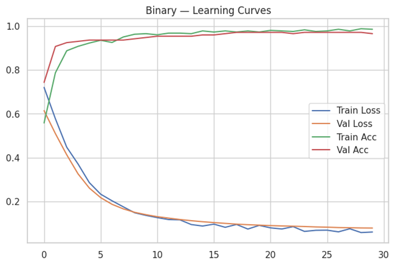
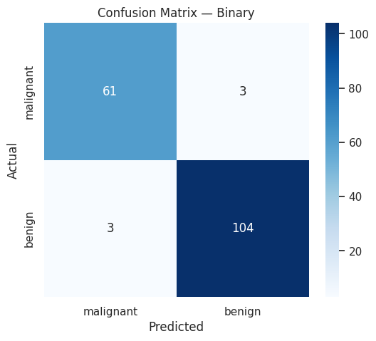
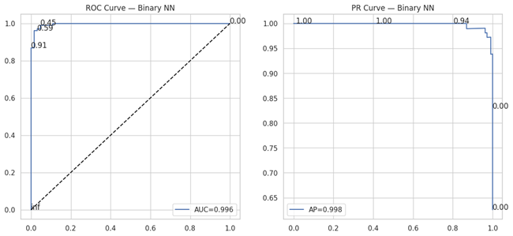
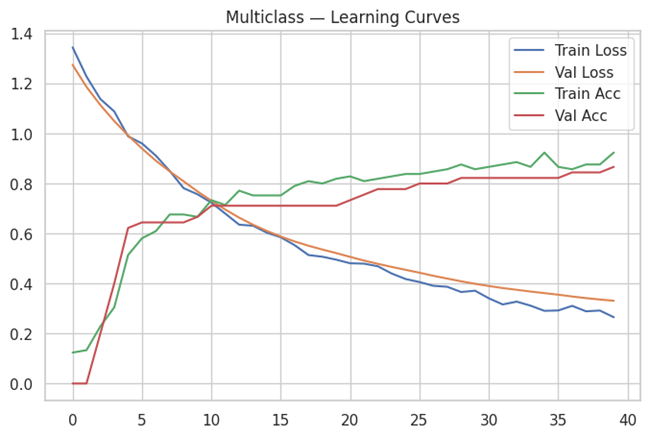

# Neural Networks for Classification (Keras)

> Implementation notes for the code and artifacts currently stored in this directory.

[](./LICENSE)

## Overview

A dense-neural-network comparison across binary, multiclass and multilabel tasks, with learning curves and common classification evaluation outputs.

## Data and assumptions

Scikit-learn Breast Cancer and Iris datasets, plus a generated multilabel classification dataset.

## Implemented workflow

- TensorFlow/Keras feed-forward classifiers
- Binary, multiclass and multilabel task examples
- Training/validation curves
- Confusion matrices, ROC/PR curves and per-class/per-label views

## Evaluation and artifacts

The artifact set is useful for comparing convergence and predictive diagnostics across three task formulations.

The following result files are present in this directory (paths checked against the repository tree):

- [learning_curve_binary.png](./learning_curve_binary.png)
- [confusion_matrix_binary.png](./confusion_matrix_binary.png)
- [roc_pr_curve_binary.png](./roc_pr_curve_binary.png)
- [learning_curve_multiclass.png](./learning_curve_multiclass.png)
- [confusion_matrix_multiclass.png](./confusion_matrix_multiclass.png)
- [learning_curve_multilabel.png](./learning_curve_multilabel.png)
- [roc_pr_curve_label0.png](./roc_pr_curve_label0.png)

### Selected visualizations









## Run and dependencies

- Implementation: [NN.py](./NN.py)
- Dependencies: [requirements.txt](./requirements.txt)
```bash
pip install -r "requirements.txt"
# Then run the script in a notebook-compatible environment as described above.
```

## Limitations and reproducibility notes

- The script contains IPython package-install magic; run it in a notebook-compatible environment as written or remove the `!pip` lines after installing the pinned dependencies.
- The requirements pin TensorFlow-related packages; use a compatible Python/platform combination and validate the install in a clean environment.
- Reported results are not asserted as independently rerun here.

## Author

Shubham Kumar Singh

## License

Licensed under the MIT License. See [`./LICENSE`](./LICENSE). The complete license text is included below for portability.

```text
MIT License

Copyright (c) 2026 Shubham Kumar Singh

Permission is hereby granted, free of charge, to any person obtaining a copy
of this software and associated documentation files (the "Software"), to deal
in the Software without restriction, including without limitation the rights
to use, copy, modify, merge, publish, distribute, sublicense, and/or sell
copies of the Software, and to permit persons to whom the Software is
furnished to do so, subject to the following conditions:

The above copyright notice and this permission notice shall be included in all
copies or substantial portions of the Software.

THE SOFTWARE IS PROVIDED "AS IS", WITHOUT WARRANTY OF ANY KIND, EXPRESS OR
IMPLIED, INCLUDING BUT NOT LIMITED TO THE WARRANTIES OF MERCHANTABILITY,
FITNESS FOR A PARTICULAR PURPOSE AND NONINFRINGEMENT. IN NO EVENT SHALL THE
AUTHORS OR COPYRIGHT HOLDERS BE LIABLE FOR ANY CLAIM, DAMAGES OR OTHER
LIABILITY, WHETHER IN AN ACTION OF CONTRACT, TORT OR OTHERWISE, ARISING FROM,
OUT OF OR IN CONNECTION WITH THE SOFTWARE OR THE USE OR OTHER DEALINGS IN THE
SOFTWARE.
```
