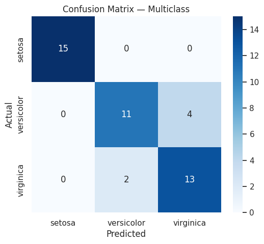
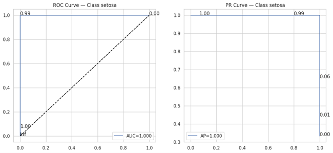
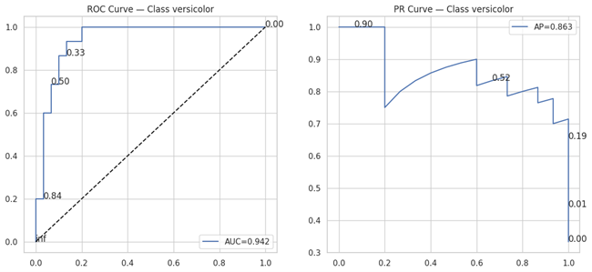
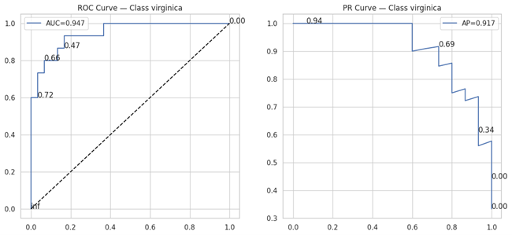
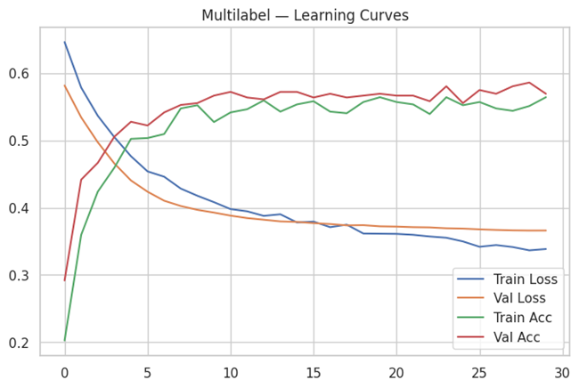
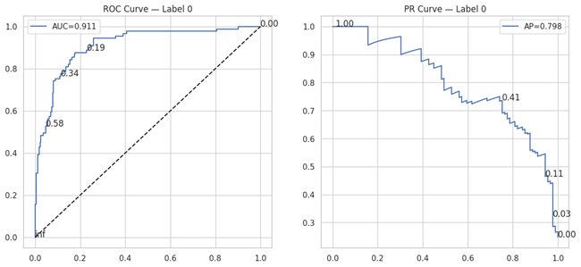
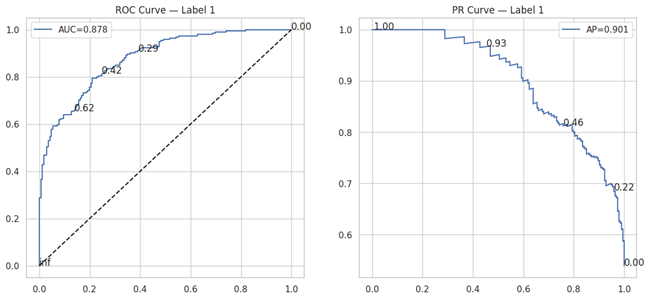
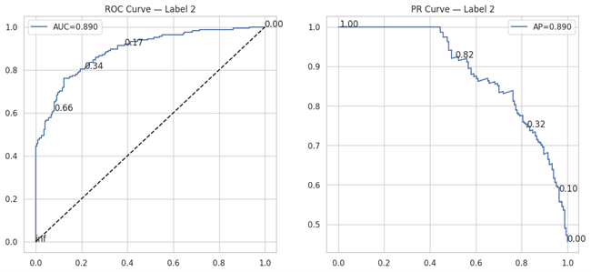

# 🧠 Neural Networks (Keras) — Binary, Multiclass & Multilabel Classification

The **Neural Network (Keras)** model is a flexible deep-learning approach that learns nonlinear decision boundaries through layered representations.  
This project demonstrates end-to-end implementation for **Binary**, **Multiclass**, and **Multilabel** classification with complete training visualization and evaluation.

---

## 🚀 Key Highlights  
✅ Implemented with TensorFlow 2.19 / Keras 2.19  
✅ Covers three tasks – Binary, Multiclass, and Multilabel classification  
✅ Comprehensive visualizations – Learning Curves, Confusion Matrices, ROC and PR Curves  
✅ Evaluates Log Loss, Brier Score, MCC, Hamming Loss, and Jaccard Index  
✅ Demonstrates dropout regularization and ReLU / Sigmoid / Softmax activations  

---

## 📊 Binary Classification — Breast Cancer Dataset

### Learning Curve  

### Confusion Matrix  

### ROC & PR Curves  

---

## 🌈 Multiclass Classification — Iris Dataset

### Learning Curve  

### Confusion Matrix  

### ROC & PR Curves (per class)  
  
  

---

## 🔢 Multilabel Classification — Synthetic Dataset

### Learning Curve  

### ROC & PR Curves (per label)  
  
  

---

## 🧮 Model Performance Summary

| Task | Dataset | Accuracy | F1 | AUC | Hamming | Jaccard |
|------|----------|-----------|----|------|----------|----------|
| Binary | Breast Cancer | 0.96 | 0.96 | 0.99 | — | — |
| Multiclass | Iris | 0.87 | 0.87 | — | — | — |
| Multilabel | Synthetic | — | 0.74 | — | 0.17 | 0.59 |

---

## 🔬 Insights  
- **Binary Model:** Shows excellent recall and calibration, achieving AUC ≈ 0.99.  
- **Multiclass Model:** Clearly separates Iris species despite overlapping petal features.  
- **Multilabel Model:** Balanced performance with Hamming Loss ≈ 0.17 and Jaccard ≈ 0.59.  

---

## 🔮 Future Enhancements  
- Introduce Batch Normalization and Early Stopping  
- Add Cross-Validation via Keras Wrappers (`KerasClassifier`)  
- Extend to text or image domains with CNN / RNN architectures  

---

## 👨‍💻 Author  
**Shubham Singh**

---

## 📜 License  
MIT License
