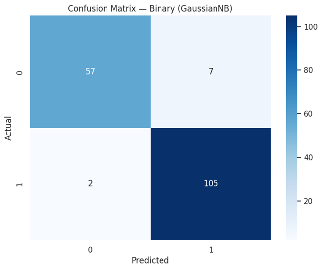
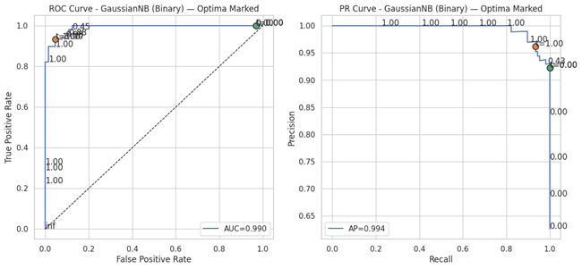
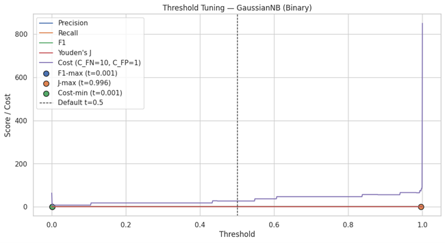
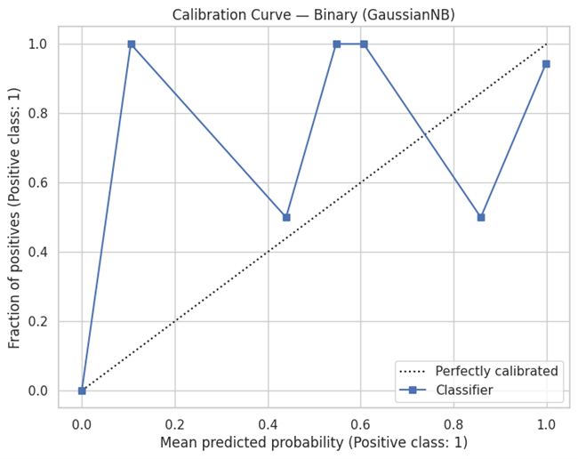

# Naïve Bayes Classification

> Implementation notes for the code and artifacts currently stored in this directory.

[](./LICENSE)

## Overview

A Gaussian Naïve Bayes-focused implementation comparing binary, multiclass and multilabel classification, with probabilistic evaluation and feature-distribution views.

## Data and assumptions

Scikit-learn Breast Cancer and Iris datasets, plus a generated multilabel classification dataset.

## Implemented workflow

- GaussianNB for the main examples
- One-vs-rest multiclass/multilabel setup
- Stratified cross-validation
- Threshold tuning, ROC/PR, calibration and feature distribution plots

## Evaluation and artifacts

Use the plots to inspect probabilistic classification behavior and where simple distributional assumptions may or may not fit.

The following result files are present in this directory (paths checked against the repository tree):

- [confusion_matrix_binary.png](./confusion_matrix_binary.png)
- [roc_pr_curve_binary.png](./roc_pr_curve_binary.png)
- [threshold_tuning_binary.png](./threshold_tuning_binary.png)
- [calibration_curve_binary.png](./calibration_curve_binary.png)
- [confusion_matrix_multiclass.png](./confusion_matrix_multiclass.png)
- [roc_curve_multiclass.png](./roc_curve_multiclass.png)
- [confusion_matrix_label_0_multilabel.png](./confusion_matrix_label_0_multilabel.png)

### Selected visualizations









## Run and dependencies

- Implementation: [NaiveBayes.py](./NaiveBayes.py)
- Dependencies: [requirements.txt](./requirements.txt)
```bash
pip install -r "requirements.txt"
python "NaiveBayes.py"
```

## Limitations and reproducibility notes

- The code includes dataset generation and loads the other examples from scikit-learn.
- GaussianNB’s conditional-independence and feature-distribution assumptions are modeling assumptions, not guarantees about the dataset.

## Author

Shubham Kumar Singh

## License

Licensed under the MIT License. See [`./LICENSE`](./LICENSE). The complete license text is included below for portability.

```text
MIT License

Copyright (c) 2026 Shubham Kumar Singh

Permission is hereby granted, free of charge, to any person obtaining a copy
of this software and associated documentation files (the "Software"), to deal
in the Software without restriction, including without limitation the rights
to use, copy, modify, merge, publish, distribute, sublicense, and/or sell
copies of the Software, and to permit persons to whom the Software is
furnished to do so, subject to the following conditions:

The above copyright notice and this permission notice shall be included in all
copies or substantial portions of the Software.

THE SOFTWARE IS PROVIDED "AS IS", WITHOUT WARRANTY OF ANY KIND, EXPRESS OR
IMPLIED, INCLUDING BUT NOT LIMITED TO THE WARRANTIES OF MERCHANTABILITY,
FITNESS FOR A PARTICULAR PURPOSE AND NONINFRINGEMENT. IN NO EVENT SHALL THE
AUTHORS OR COPYRIGHT HOLDERS BE LIABLE FOR ANY CLAIM, DAMAGES OR OTHER
LIABILITY, WHETHER IN AN ACTION OF CONTRACT, TORT OR OTHERWISE, ARISING FROM,
OUT OF OR IN CONNECTION WITH THE SOFTWARE OR THE USE OR OTHER DEALINGS IN THE
SOFTWARE.
```
