# 🧠 Naïve Bayes (GaussianNB) — Binary, Multiclass & Multilabel Classification

This project implements **Naïve Bayes classifiers** (GaussianNB) for three tasks — **Binary**, **Multiclass**, and **Multilabel** classification — demonstrating their behavior with detailed evaluation metrics, calibration, and visualization.

---

## 🚀 Key Highlights
✅ GaussianNB applied across Binary, Multiclass, and Multilabel datasets  
✅ Includes Cross-Validation (5-fold), ROC/PR Curves with annotated thresholds  
✅ Calibration curves for model reliability assessment  
✅ Feature distribution plots to validate Gaussian assumptions  
✅ Optimal Threshold Table and Cost Function visualization (Binary)  

---

## 📊 Binary Classification — Breast Cancer Dataset

### Confusion Matrix

### ROC & PR Curves

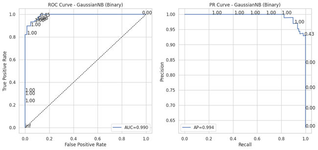

### Threshold Tuning

### Calibration Curve

### Feature Distributions
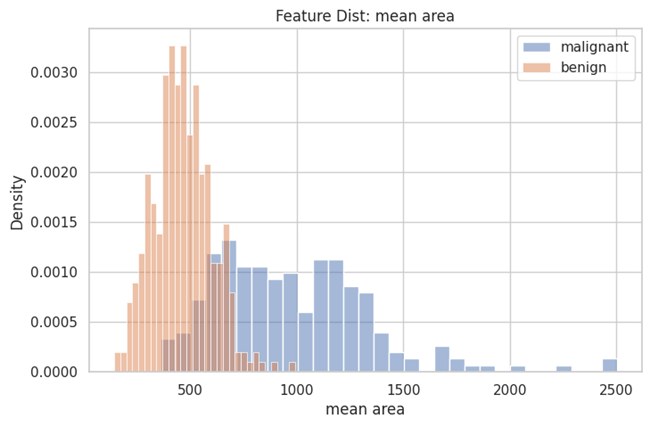
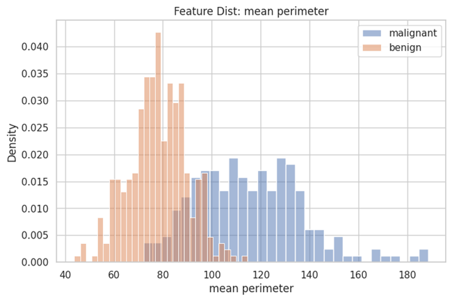
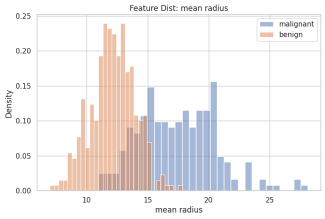

---

## 🌈 Multiclass Classification — Iris Dataset

### Confusion Matrix
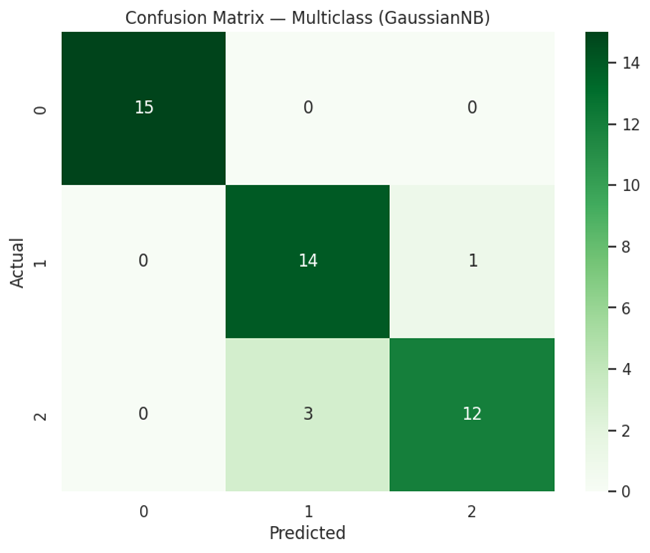

### ROC & PR Curves
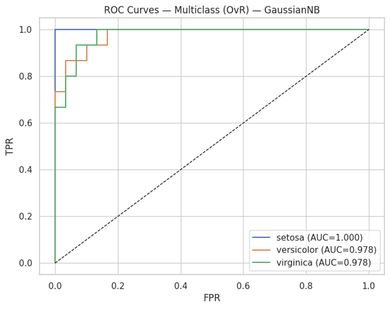
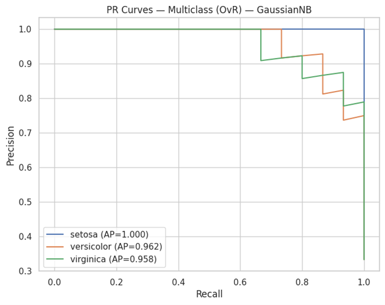

### Calibration Curves
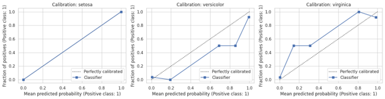

### Feature Distributions
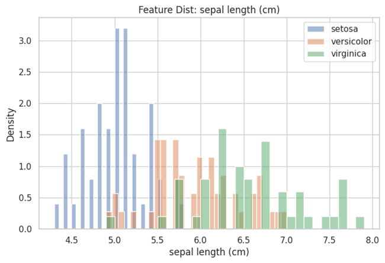
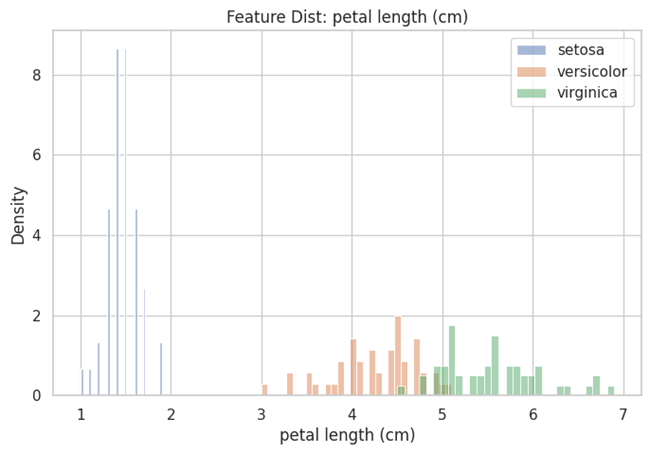

---

## 🔢 Multilabel Classification — Synthetic Dataset

### Confusion Matrix (Label 0)
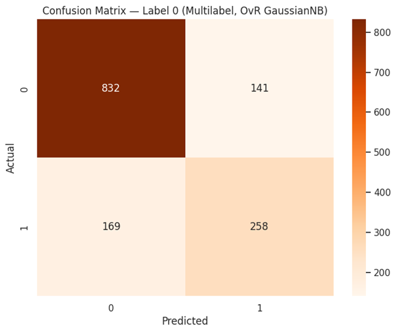

### ROC Curves (per label)
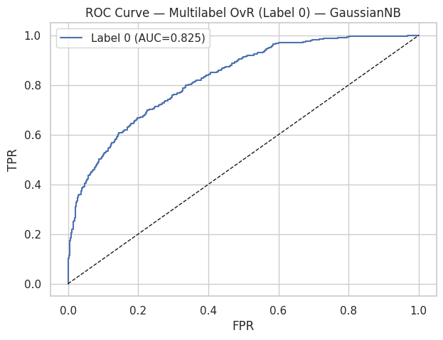
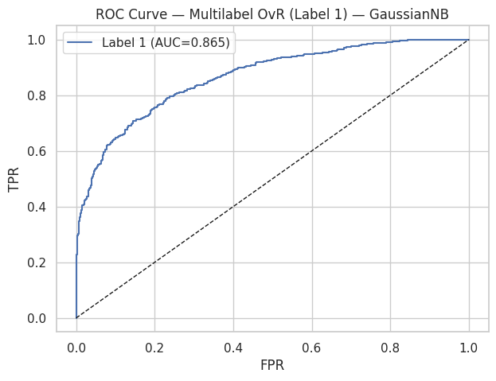
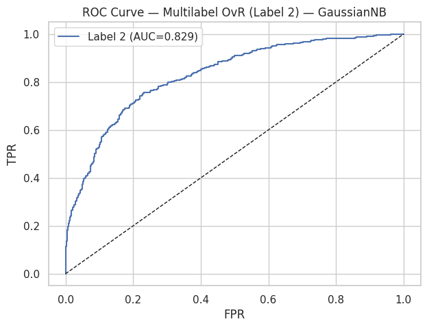

### PR Curves (per label)
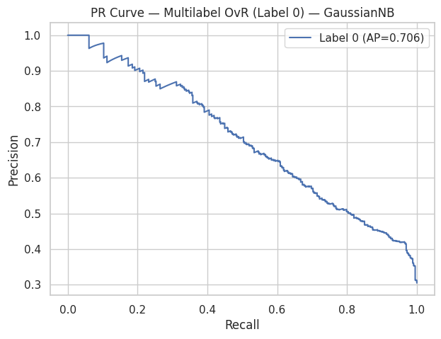
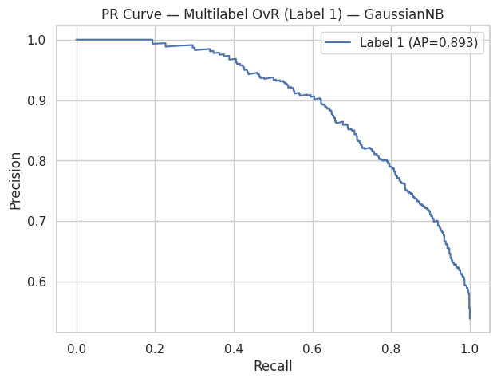
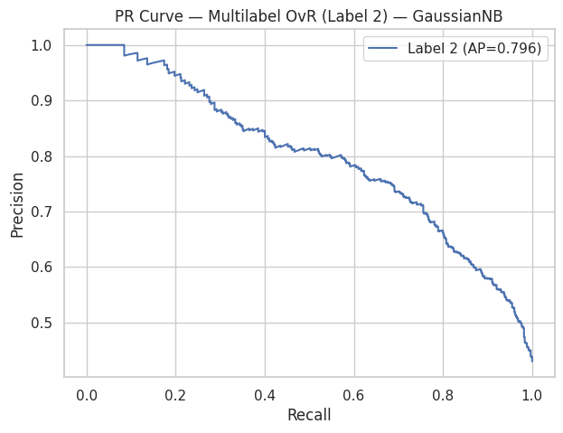

---

## 🧮 Model Performance Summary

| Task | Dataset | Accuracy | F1 | AUC | Hamming | Jaccard |
|------|----------|-----------|----|------|----------|----------|
| Binary | Breast Cancer | 0.95 | 0.96 | 0.989 | — | — |
| Multiclass | Iris | 0.91 | 0.91 | — | — | — |
| Multilabel | Synthetic | — | 0.68 | — | 0.201 | 0.520 |

---

## 🔬 Insights
- **Binary:** Excellent separability and calibration; GaussianNB aligns with breast cancer feature distribution.  
- **Multiclass:** Clear probabilistic decision boundaries for each Iris species.  
- **Multilabel:** Maintains balanced precision-recall tradeoff across multiple correlated labels.  

---

## 🔮 Future Enhancements
- Implement **BernoulliNB** and **MultinomialNB** variants for discrete data  
- Extend to **text classification** with TF-IDF features  
- Add **Bayesian hyperparameter tuning** for prior adjustment  

---

## 👨‍💻 Author
**Shubham Singh**

---

## 📜 License
MIT License
