# ⚙️ Support Vector Machine (SVM) — Binary, Multiclass & Multilabel Classification

The **Support Vector Machine (SVM)** algorithm is a powerful kernel-based method that finds the optimal separating hyperplane between classes.  
This project demonstrates the application of **SVM (RBF kernel)** and **LinearSVC** across **Binary**, **Multiclass**, and **Multilabel** classification tasks, showcasing model tuning, evaluation, and visualization.

---

## 🚀 Key Highlights
✅ Implemented with both **RBF** and **LinearSVC** variants  
✅ Applied on Binary, Multiclass, and Multilabel datasets  
✅ Includes **5-fold Cross-Validation**, **ROC/PR Curves**, and **Calibration** plots  
✅ **Threshold Tuning** with optimal thresholds (F1-max, J-max, Cost-min)  
✅ Detailed **Confusion Matrices** and **Per-Class Calibration Curves**

---

## 📊 Binary Classification — Breast Cancer Dataset

### Confusion Matrix  
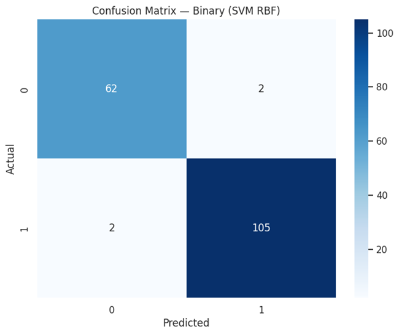

### ROC & PR Curves  
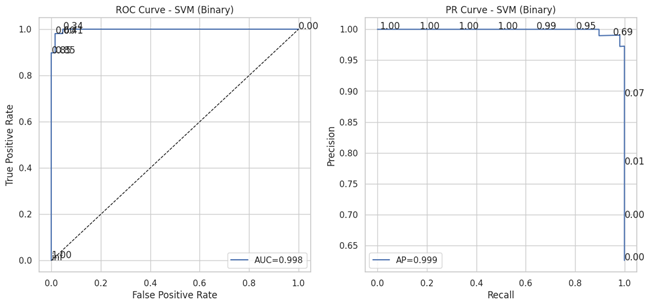  
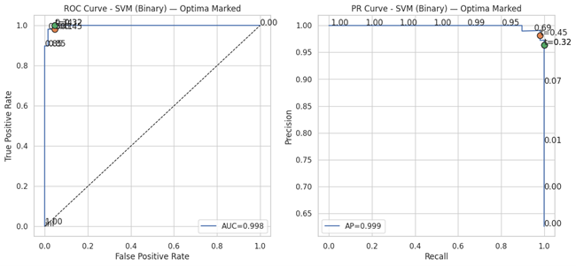

### Threshold Tuning  
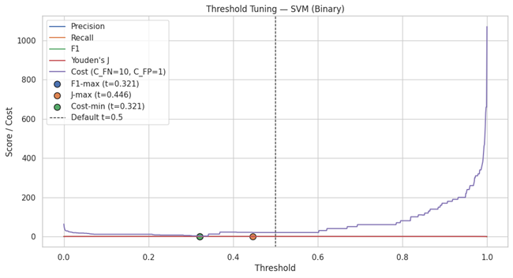

### Calibration Curve  
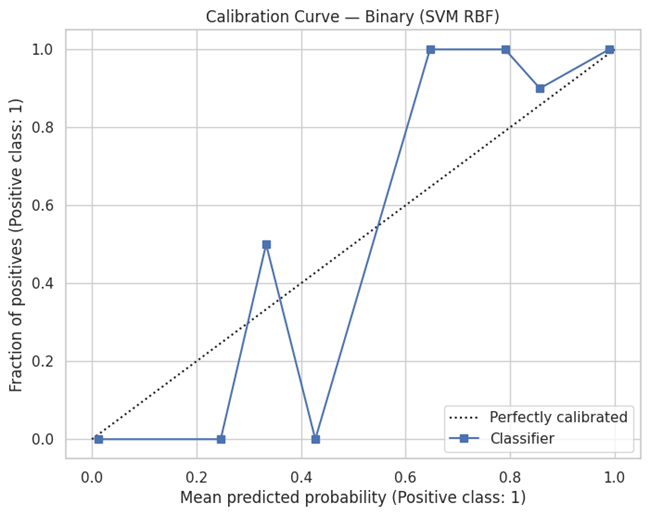

---

## 🌈 Multiclass Classification — Iris Dataset

### Confusion Matrix  
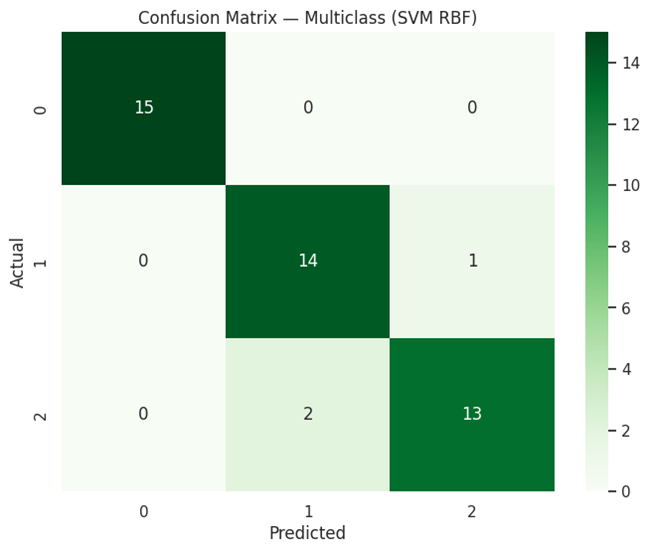

### ROC & PR Curves  
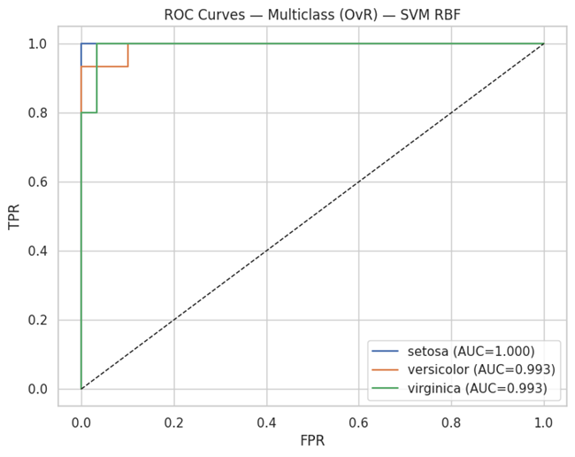  
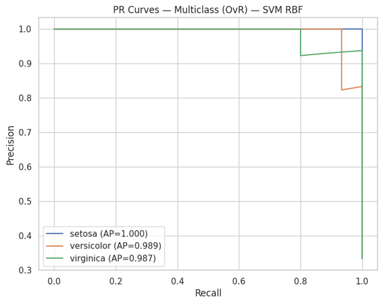

### Calibration Curves (Per Class)  
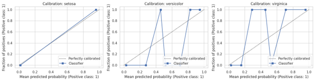

---

## 🔢 Multilabel Classification — Synthetic Dataset

### Confusion Matrix (Label 0)  
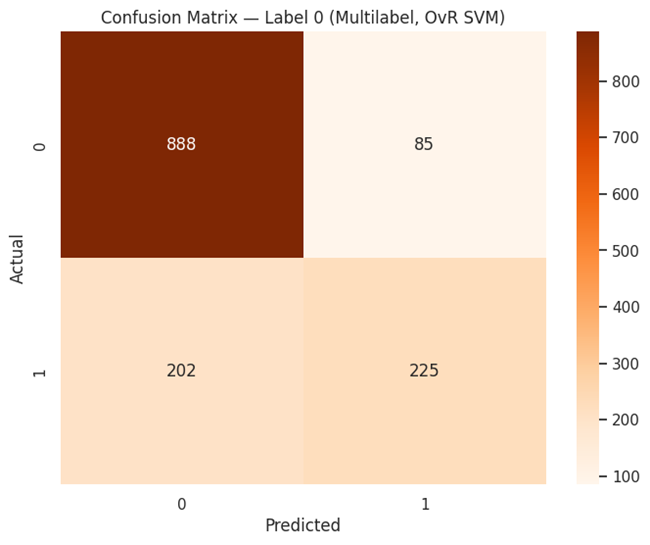

### ROC Curves (per label)  
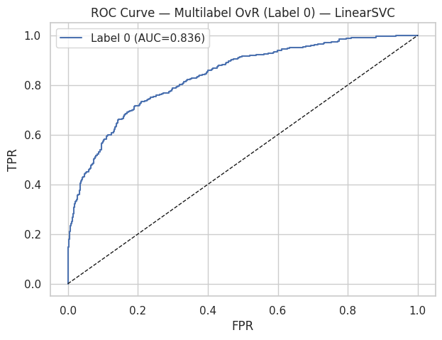  
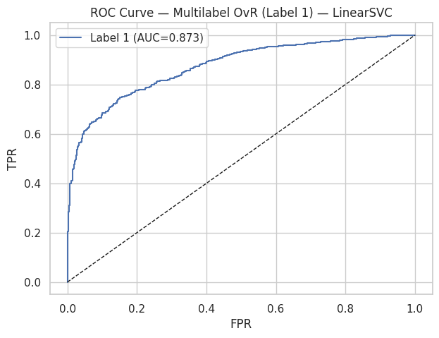  
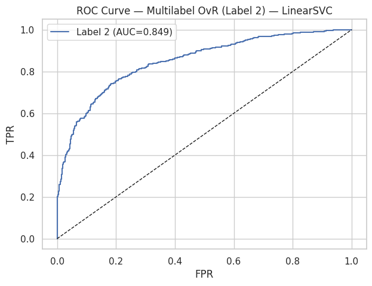

### PR Curves (per label)  
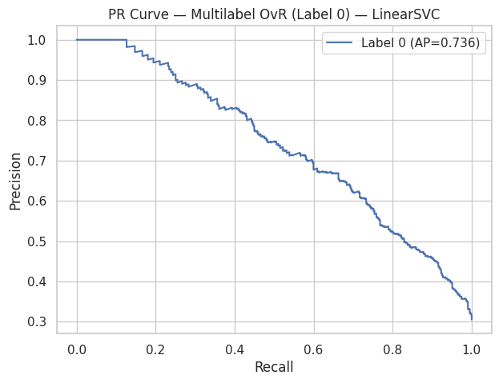  
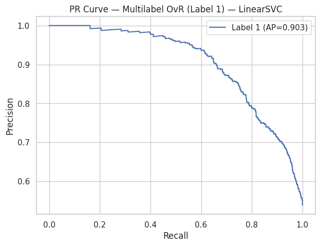  
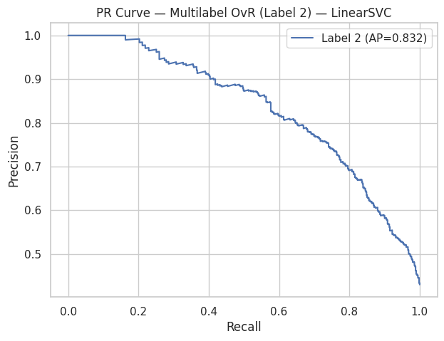

---

## 🧮 Model Performance Summary

| Task | Dataset | Accuracy | F1 | AUC | Hamming | Jaccard |
|------|----------|-----------|----|------|----------|----------|
| Binary | Breast Cancer | 0.98 | 0.98 | 0.99 | — | — |
| Multiclass | Iris | 0.93 | 0.93 | — | — | — |
| Multilabel | Synthetic | — | 0.69 | — | 0.186 | 0.528 |

---

## 🔬 Insights
- **Binary (RBF SVM):** Achieved 98% accuracy and AUC ≈ 0.99 with excellent calibration.  
- **Multiclass:** High precision across species with clear OvR separation.  
- **Multilabel:** Balanced F1 across labels, effective under moderate correlation.  
- **Threshold Optimization:** Cost-based tuning reduces false negatives under asymmetric penalties.

---

## 🔮 Future Enhancements
- Integrate **Polynomial** and **Sigmoid kernels** for comparison  
- Use **GridSearchCV / Optuna** for hyperparameter tuning  
- Incorporate **SHAP** and **LIME** explainability visualizations  

---

## 👨‍💻 Author
**Shubham Singh**

---

## 📜 License
MIT License
