# 🌳 Decision Tree Classifier — Binary, Multiclass & Multilabel

This project demonstrates **Decision Trees** applied across  
1️⃣ Binary classification (Breast Cancer),  
2️⃣ Multiclass classification (Iris), and  
3️⃣ Multilabel tasks (Synthetic dataset).  

It includes threshold tuning, ROC/PR curve annotation, calibration, feature importance visualization, and tree structure plotting.

---

## 🚀 Key Highlights
- **Binary:** Threshold tuning (F1-max, Youden-J, Cost-min) + ROC/PR curves  
- **Multiclass:** One-vs-Rest ROC/PR visualization + classwise metrics  
- **Multilabel:** Mean feature importance across all label estimators  
- **Extra:** Cross-validation summary, calibration curves, and interpretable decision tree plots (depth ≤ 3)

---

## 📊 Binary Classification (Breast Cancer Dataset)

| Metric | Mean ± SD (5-fold CV) |
|:-------|:---------------------:|
| Accuracy | 0.910 ± 0.028 |
| Precision | 0.920 ± 0.039 |
| Recall | 0.941 ± 0.010 |
| F1 | 0.930 ± 0.020 |
| ROC AUC | 0.900 ± 0.037 |
| Log Loss | −3.229 ± 1.005 |

✅ **Best Thresholds (Binary Decision Tree):**

| Criterion | Threshold | Precision | Recall | F1 | Youden J | Cost |
|:-----------|:----------:|:----------:|:------:|:-----------:|:------:|
| F1-max | 0.001 | 0.935 | 0.935 | 0.935 | 0.825 | 77 |
| J-max | 0.001 | 0.935 | 0.935 | 0.935 | 0.825 | 77 |
| Cost-min | 0.000 | 0.626 | 1.000 | 0.770 | 0.000 | 64 |

---

## 📈 Binary Evaluation Visuals
### Confusion Matrix  
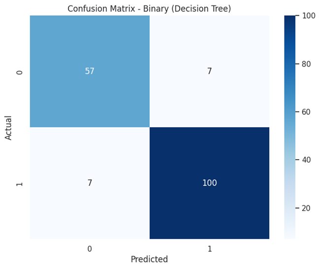

### ROC & PR Curves  
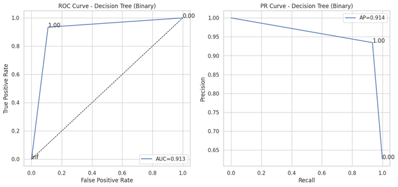  
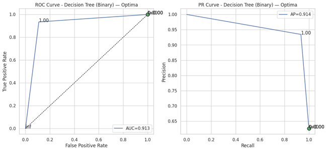

### Threshold Tuning  
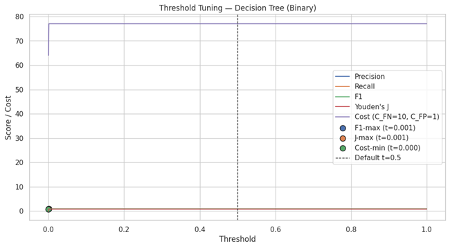

### Calibration Curve  
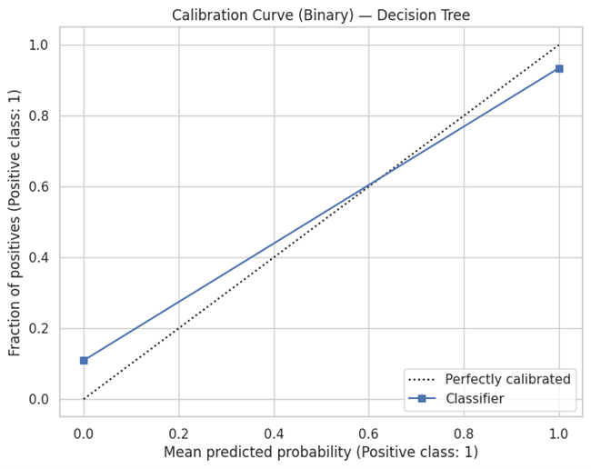

### Feature Importance  
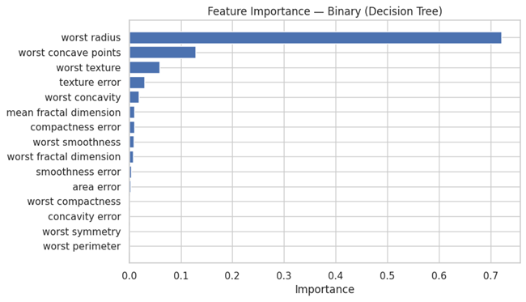

### Tree Structure (Depth ≤ 3)  
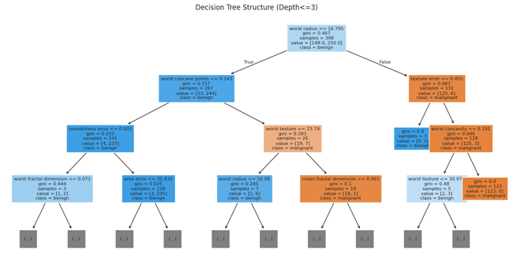

---

## 🌈 Multiclass Classification (Iris Dataset)

| Metric | Mean ± SD (5-fold CV) |
|:-------|:---------------------:|
| Accuracy | 0.953 ± 0.034 |
| F1 Macro | 0.953 ± 0.034 |
| F1 Micro | 0.953 ± 0.034 |
| Log Loss | −1.682 ± 1.225 |

### Multiclass Confusion Matrix  
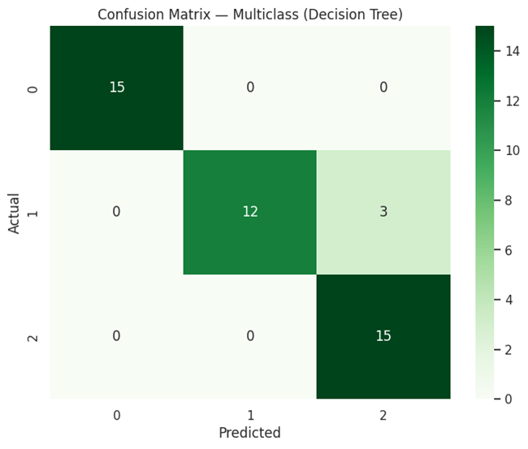

### ROC & PR Curves (OvR)  
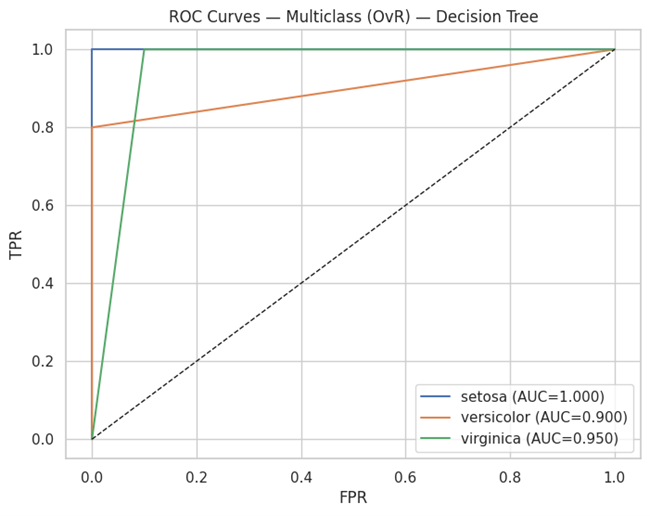  
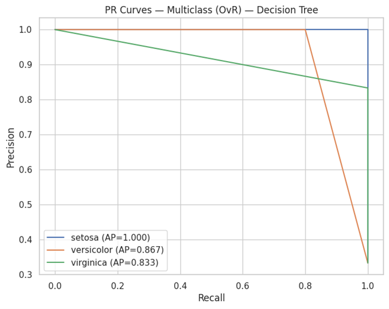

### Feature Importance  
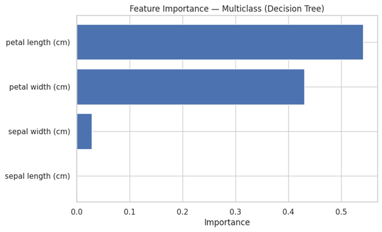

### Tree Visualization  
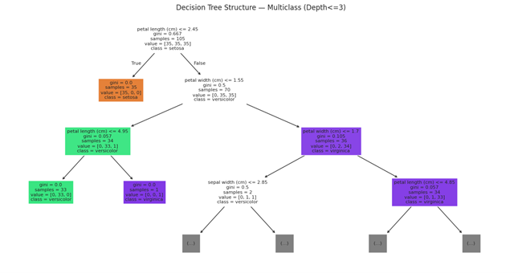

---

## 🧩 Multilabel Classification (Synthetic Dataset)

| Metric | Value |
|:-------|:------:|
| Subset Accuracy | 0.18 |
| Hamming Loss | 0.280 |
| Jaccard (Micro) | 0.413 |

### Confusion Matrix (Label 0)  
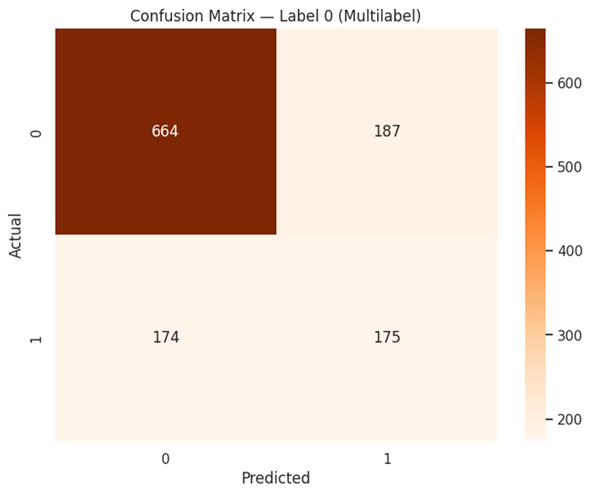

### Feature Importance (Mean across Labels)  
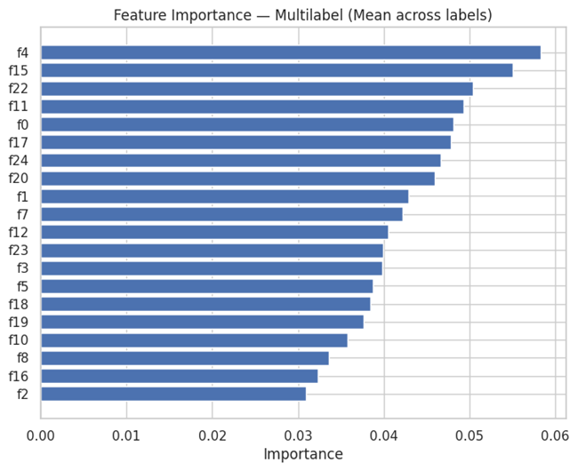

---

## 💡 Insights
- Decision Trees excel at **interpretable rules**, making them ideal baselines.  
- **Threshold tuning** adjusts model bias toward precision or recall depending on cost asymmetry.  
- **Calibration plots** help verify probability reliability.  
- Multilabel trees highlight **mean feature relevance** across correlated outputs.  

---

## 🔮 Future Enhancements
- Add **Pruning vs Depth trade-off visualization**  
- Integrate **Ensemble methods (Random Forest, XGBoost)**  
- Implement **SHAP explanations for tree-based interpretability**

---

## 👨‍💻 Author
**Shubham Singh**

---

## 📜 License
MIT License
