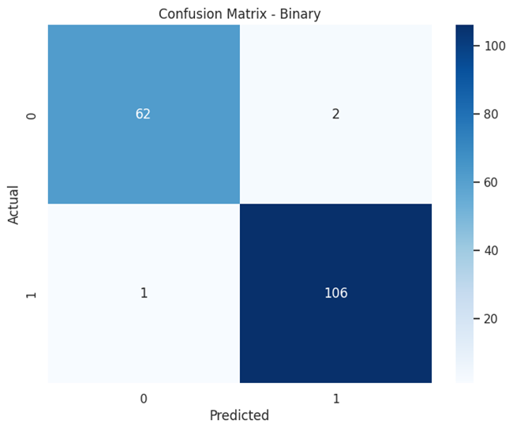
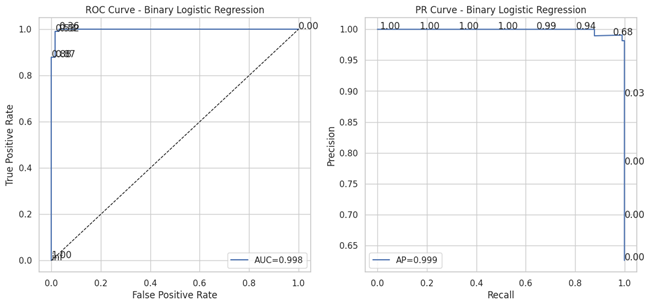
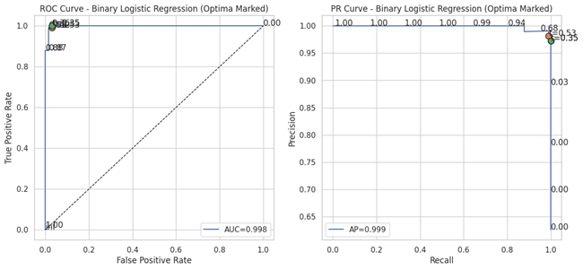
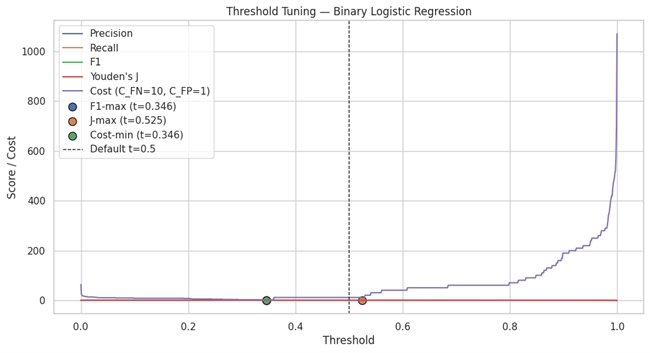
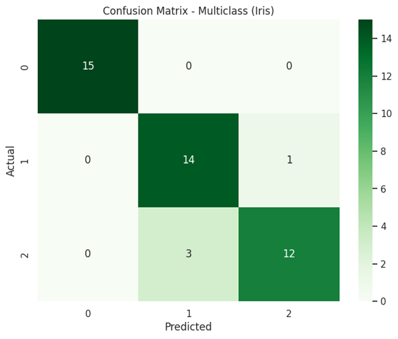
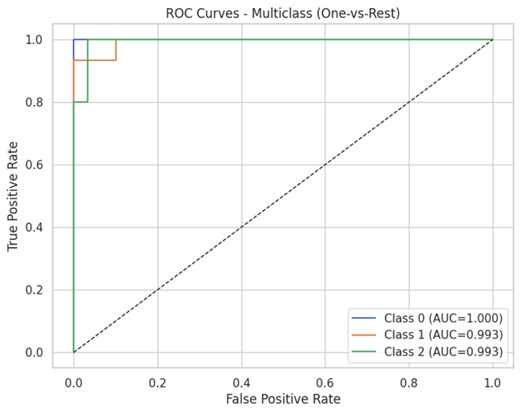
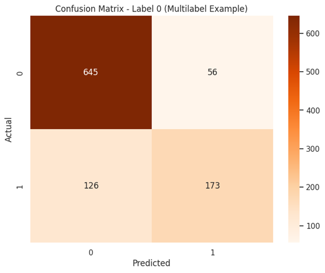

# ⚖️ Logistic Regression — Binary, Multiclass & Multilabel Classification

This project demonstrates **Logistic Regression** across **binary**, **multiclass**, and **multilabel** problems using scikit-learn.  
It includes full coverage of evaluation techniques — confusion matrices, ROC/PR curves, optimal threshold tuning, and cost-based decision analysis.

---

## 🚀 Key Highlights
- **Binary Classification:** Breast Cancer dataset (sklearn)  
  - 5-fold CV metrics + annotated ROC/PR curves  
  - Precision–Recall–F1–Youden’s J–Cost tuning  
  - Optimal threshold table for F1-max, J-max & Cost-min  
- **Multiclass Classification:** Iris dataset  
  - One-vs-Rest (OvR) ROC plots per class + CV metrics  
- **Multilabel Classification:** Synthetic dataset  
  - One-vs-Rest (Logistic Regression) with global metrics (Hamming Loss, Jaccard, Subset Accuracy)

---

## 📊 Binary Classification Results (Sklearn Breast Cancer)

| Metric | Mean ± SD (5-fold CV) |
|:-------|:---------------------:|
| Accuracy | 0.974 ± 0.017 |
| Precision | 0.968 ± 0.029 |
| Recall | 0.992 ± 0.011 |
| F1 | 0.979 ± 0.013 |
| ROC AUC | 0.995 ± 0.006 |

✅ **Best Threshold (F1-max): t ≈ 0.35** → F1 = 0.991  J = 0.969  Cost = 2  

---

## 📈 Evaluation Visuals

### 🔹 Binary Confusion Matrix  

### 🔹 ROC & PR Curves (annotated thresholds)  
  

### 🔹 Threshold Tuning Curve  

---

## 🌈 Multiclass Classification — Iris Dataset

| Metric | Mean ± SD (5-fold CV) |
|:-------|:---------------------:|
| Accuracy | 0.960 ± 0.039 |
| F1 Macro | 0.960 ± 0.039 |
| F1 Micro | 0.960 ± 0.039 |
| Log Loss | −0.150 ± 0.036 |

  

---

## 🧩 Multilabel Classification — Synthetic Dataset

| Metric | Value |
|:-------|:------:|
| Subset Accuracy | 0.416 |
| Hamming Loss | 0.187 |
| Jaccard (Micro) | 0.581 |

---

## 💡 Insights
- **Threshold tuning** offers interpretability across cost trade-offs.  
- **Multiclass ROC plots** enable per-class separability visualization.  
- **Multilabel setup** showcases logistic regression scalability using One-vs-Rest.  

---

## 🔮 Future Enhancements
- Integrate **calibration curves** (Platt scaling / isotonic).  
- Compare with **SVM** and **ElasticNet-penalized logistic** models.  
- Extend to **probability cost functions** for business risk alignment.

---

## 👨‍💻 Author
**Shubham Singh**

---

## 📜 License
MIT License
