# 🌲 Random Forest Classifier — Binary, Multiclass & Multilabel Classification

The **Random Forest** algorithm is a robust ensemble method that combines multiple decision trees to enhance accuracy, stability, and interpretability.  
This project demonstrates its implementation across **Binary**, **Multiclass**, and **Multilabel** problems, including detailed threshold optimization, feature importance, and calibration.

---

## 🚀 Key Highlights
✅ Applied Random Forest on three classification tasks (Binary, Multiclass, Multilabel)  
✅ Comprehensive evaluation: CV metrics, Confusion Matrices, ROC/PR Curves, Calibration Curves  
✅ **Threshold Tuning** with optimal thresholds table for Binary classification  
✅ **Feature Importance (MDI & Permutation)** with interpretive visualization  
✅ **OOB Curve** illustrating ensemble stability  

---

## 📊 Binary Classification — Breast Cancer Dataset

### Confusion Matrix  
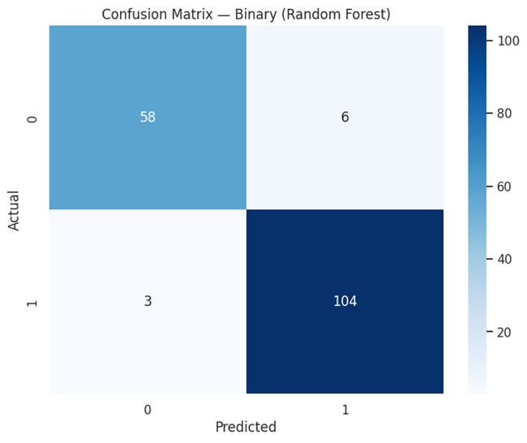

### ROC & PR Curves  
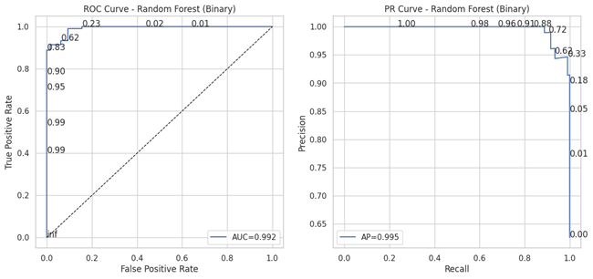  
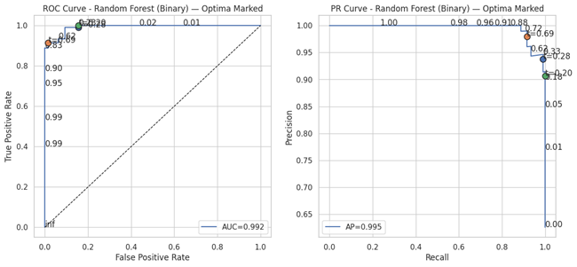

### Threshold Tuning  
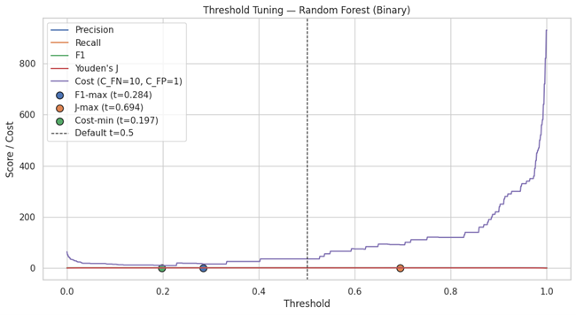

### Calibration Curve  
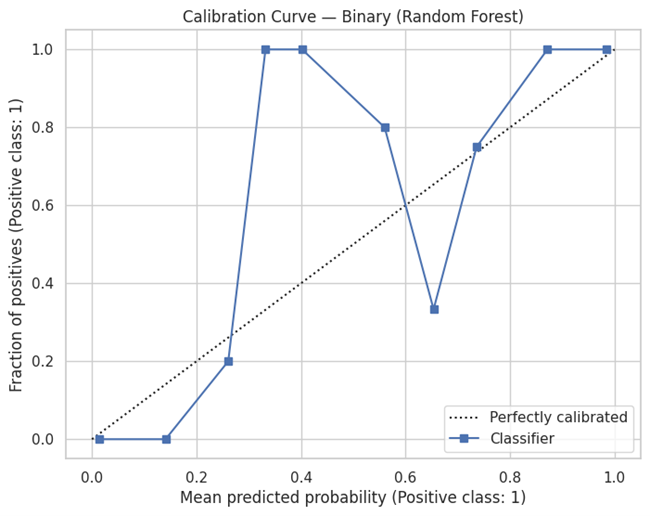

### Feature Importance  
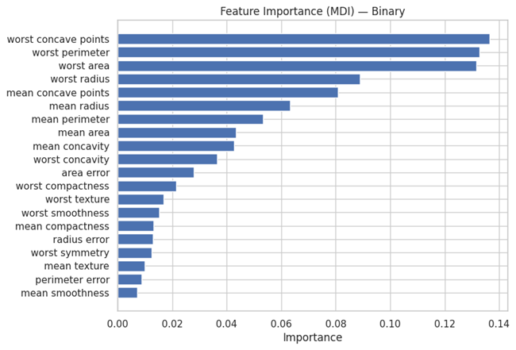

### Permutation Importance  
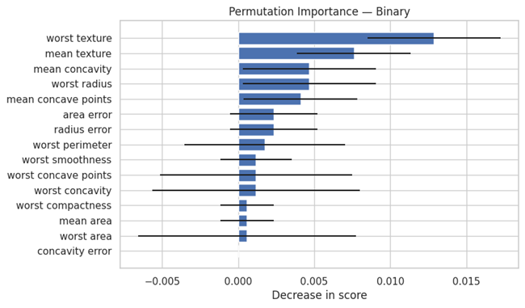

### OOB Curve  
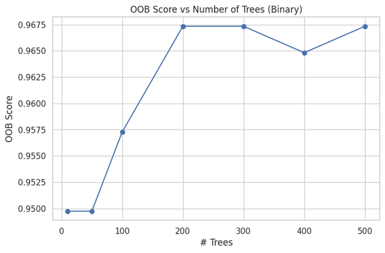

---

## 🌈 Multiclass Classification — Iris Dataset

### Confusion Matrix  
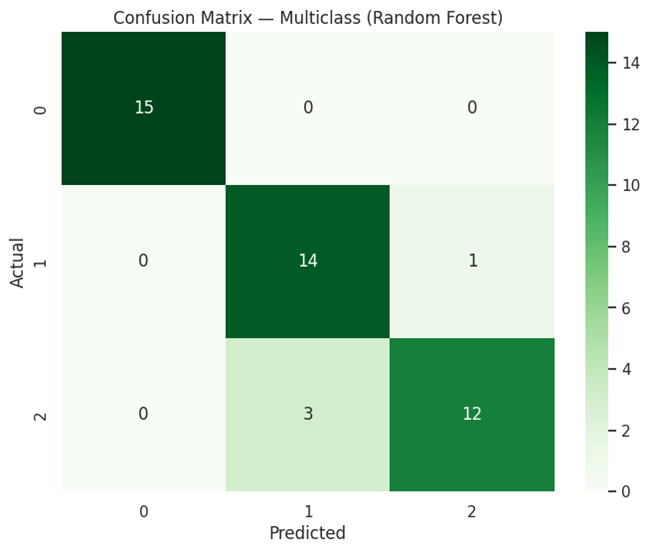

### ROC & PR Curves  
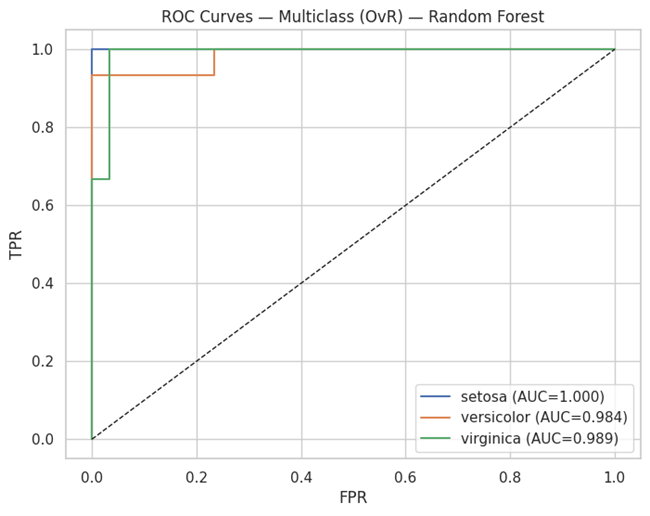  
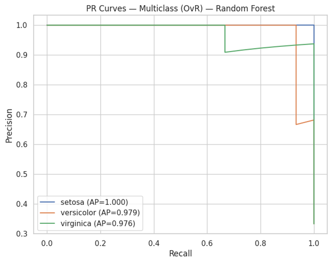

### Feature Importance  
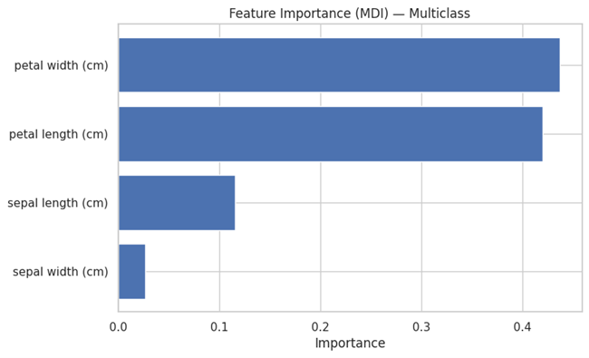

### Permutation Importance  
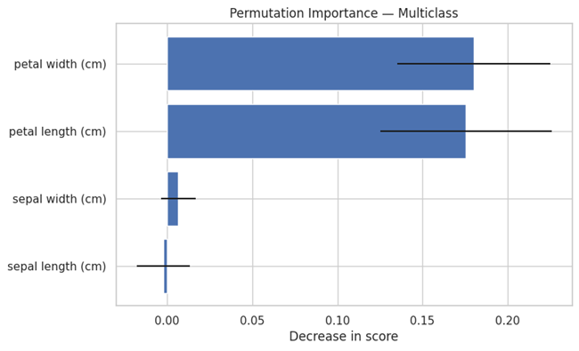

---

## 🔢 Multilabel Classification — Synthetic Dataset

### Confusion Matrix (Label 0)  
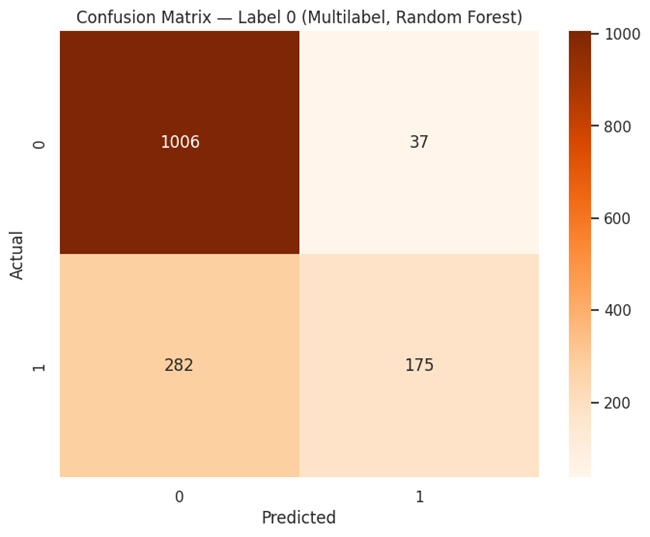

### Feature Importance  
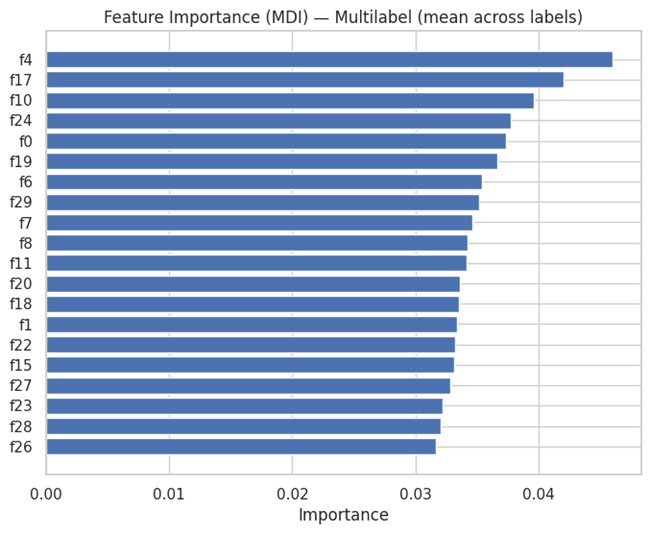

---

## 🧮 Model Performance Summary

| Task | Dataset | Accuracy | F1 | AUC | Hamming | Jaccard |
|------|----------|-----------|----|------|----------|----------|
| Binary | Breast Cancer | 0.95 | 0.96 | 0.99 | — | — |
| Multiclass | Iris | 0.91 | 0.91 | — | — | — |
| Multilabel | Synthetic | — | 0.66 | — | 0.19 | 0.50 |

---

## 🔬 Insights
- **Binary:** Strong generalization with AUC ≈ 0.99 and stable OOB score (0.967).  
- **Multiclass:** Excellent separation across Iris classes with consistent F1 scores.  
- **Multilabel:** Demonstrates balanced precision-recall with moderate label overlap.  
- **Feature Importance:** Identifies key features via both MDI and permutation metrics.  

---

## 🔮 Future Enhancements
- Integrate **GridSearchCV** or **Optuna** for hyperparameter tuning  
- Add **SHAP** interpretability plots  
- Extend to **Regression** and **Imbalanced Classification** scenarios  

---

## 👨‍💻 Author
**Shubham Singh**

---

## 📜 License
MIT License
