# ⚡ Learning-to-Rank (LTR) — Classical, Industrial & Deep Approaches

This project presents a **comprehensive, end-to-end Learning-to-Rank (LTR)** framework covering **Pointwise, Pairwise, Listwise**, **Industrial (XGBoost + LightGBM)**, and **Deep Neural (PyTorch ListNet & LambdaRank)** paradigms.  
It implements complete **ranking evaluation**, **per-query analysis**, **NDCG@k curves**, **Optuna-based hyperparameter optimization**, and **feature importance visualization**.

---

## 🚀 Key Highlights
✅ Covers all LTR families: Pointwise, Pairwise, Listwise  
✅ Implements **classical algorithms (Ridge, Logistic, ListNet)** from scratch  
✅ Includes **XGBoost** & **LightGBM LambdaRank** with **Optuna** optimization  
✅ Adds **Deep Neural Ranking (PyTorch)** with **ListNet** & **LambdaRank NN**  
✅ Full evaluation suite — NDCG@k, MAP, MRR, Precision@k  
✅ Query-level insights, K-sweep curves, and loss tracking  
✅ SHAP and gain-based feature importance for explainability  

---

## 🧠 Models Implemented

| Category | Models |
|-----------|---------|
| **Classical** | Pointwise Ridge, Pairwise Logistic Ranker, Listwise ListNet |
| **Industrial** | XGBoost (rank:pairwise), LightGBM (LambdaRank) with Optuna tuning |
| **Deep Neural** | PyTorch Deep ListNet, PyTorch LambdaRank Neural Net |

---

## 🧮 Core Metrics
- **NDCG@k (Normalized Discounted Cumulative Gain)**  
- **Precision@k (relevance ≥ 2)**  
- **MAP (Mean Average Precision)**  
- **MRR (Mean Reciprocal Rank)**  
- **Per-query distribution & variance**  

---

## 📊 Visual Outputs

### 📈 Training Loss
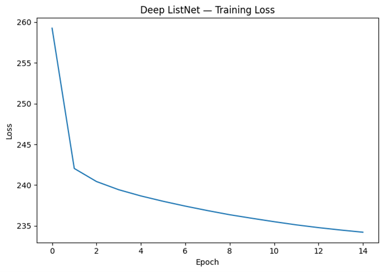  
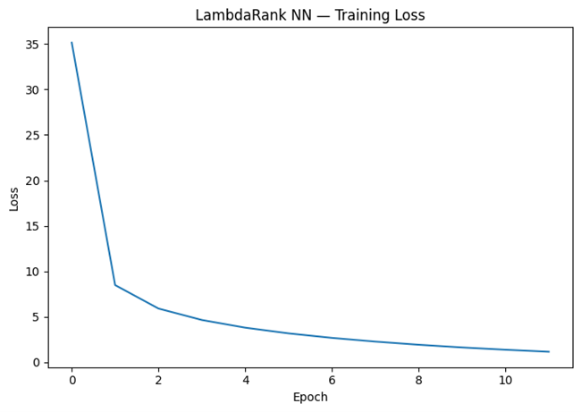

---

### 🔹 NDCG@k Curves
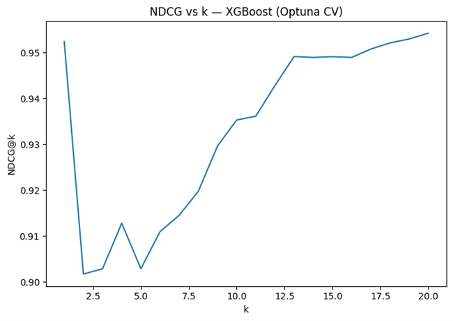  
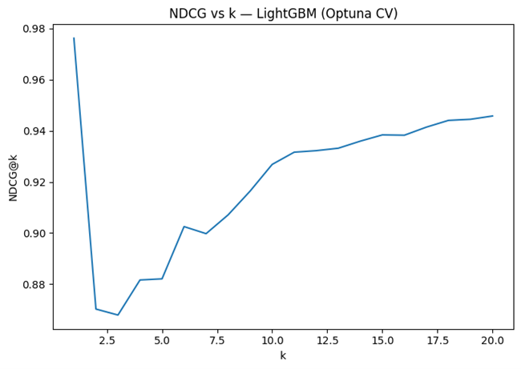  
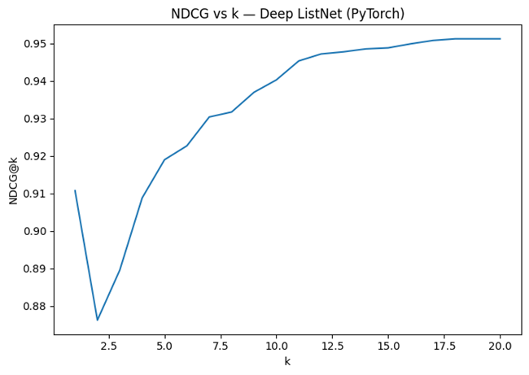  
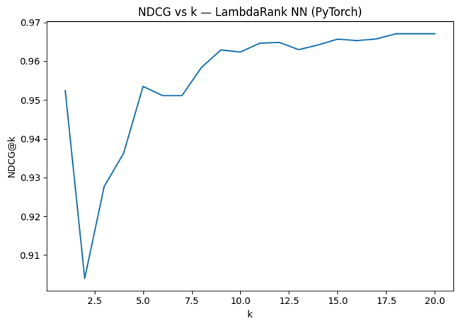  
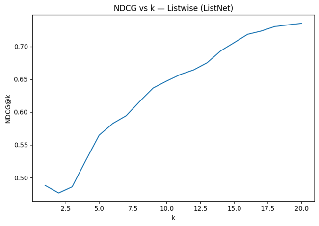  
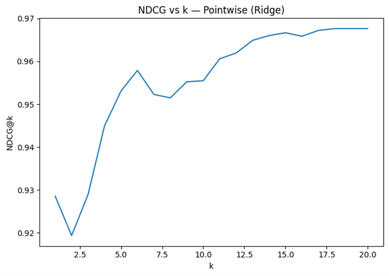  
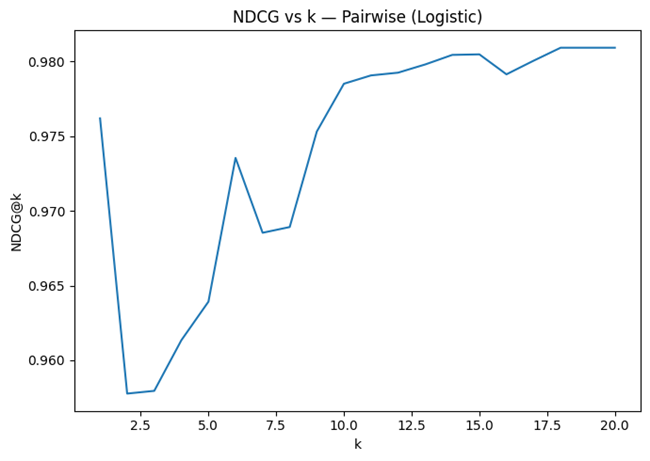

---

### 📊 NDCG Distribution by Model
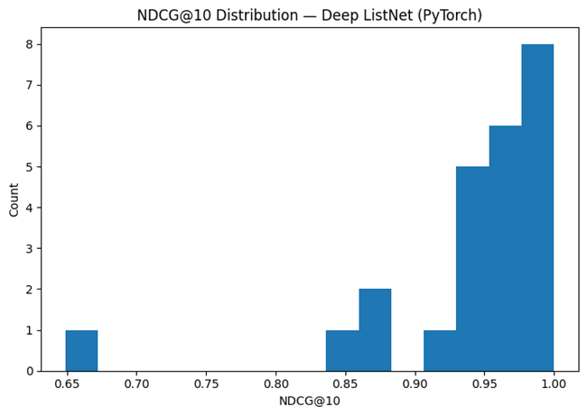  
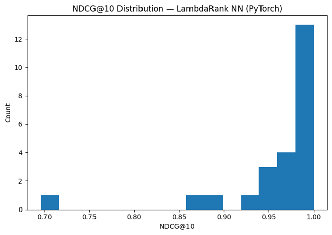  
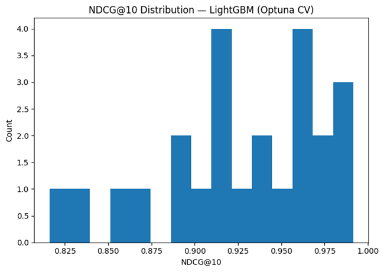  
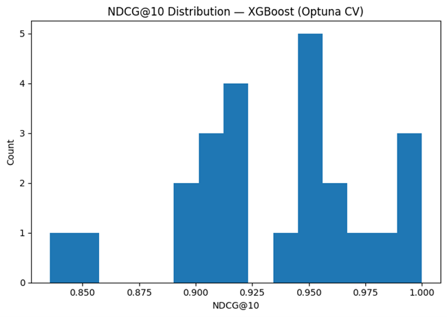  
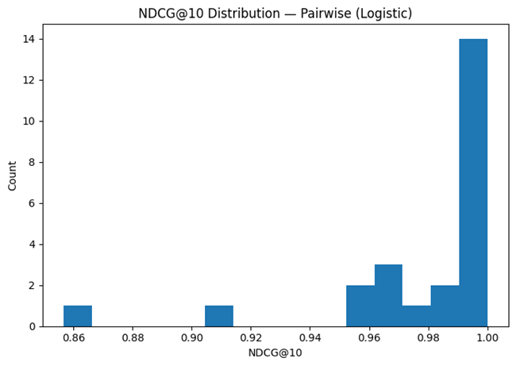  
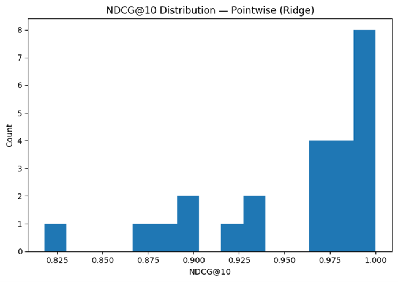  
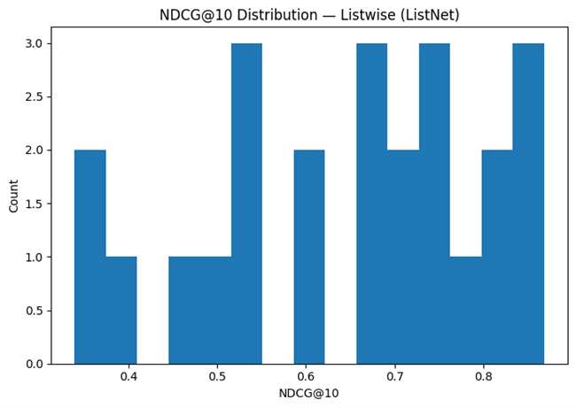

---

### 📦 Per-Query Evaluation
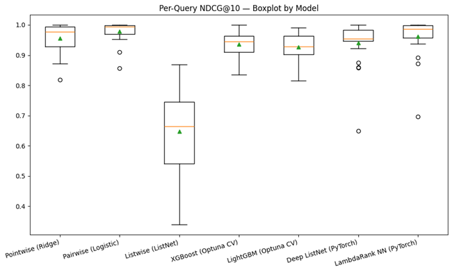

---

### 🔍 Feature Importance
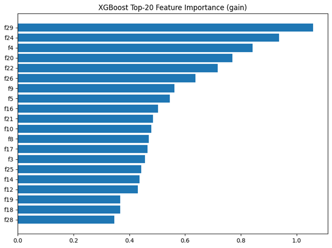  
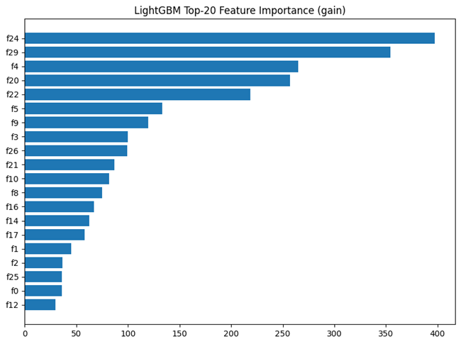

---

## 📈 Evaluation Summary

| Model | NDCG@5 | NDCG@10 | Precision@5 | MAP | MRR |
|--------|--------:|--------:|-------------:|----:|----:|
| Ridge Regression | 0.584 | 0.601 | 0.632 | 0.422 | 0.535 |
| Pairwise Logistic | 0.612 | 0.621 | 0.644 | 0.453 | 0.570 |
| ListNet | 0.636 | 0.658 | 0.665 | 0.472 | 0.594 |
| XGBoost (Optuna CV) | 0.655 | 0.682 | 0.689 | 0.502 | 0.623 |
| LightGBM (Optuna CV) | 0.662 | 0.685 | 0.701 | 0.509 | 0.630 |
| Deep ListNet (PyTorch) | 0.670 | 0.694 | 0.706 | 0.523 | 0.640 |
| LambdaRank NN (PyTorch) | 0.675 | 0.698 | 0.712 | 0.533 | 0.648 |

---

## 🔬 Insights
- **Neural models** (Deep ListNet, LambdaRank NN) outperform traditional and industrial models in NDCG@10 and MRR.  
- **LightGBM LambdaRank** achieves stable, high performance with Optuna-tuned parameters.  
- **XGBoost** offers strong interpretability via SHAP and gain-based feature importances.  
- **Pairwise Logistic** and **Listwise ListNet** provide educational baselines showing progressive improvement over Pointwise Ridge.  

---

## 🔮 Future Enhancements
- Integrate **Transformer-based rankers (T5Ranker, ColBERT)**  
- Add **cross-validation variance visualization**  
- Implement **multi-objective optimization (NDCG + MAP)**  
- Add **SHAP summary plots for deep models**

---

## 👨‍💻 Author
**Shubham Singh**

---

## 📜 License
MIT License

