# 🌳 Gradient Boosted Regression Trees (LightGBM GPU)

This project implements **Gradient Boosted Regression Trees (GBRT)** using **LightGBM (GPU accelerated)** on the **California Housing dataset**.  
It explores three optimization stages — Early Stopping, Randomized Search, and Focused Grid Search — with **complete diagnostics, feature explainability, and SHAP analysis**.

---

## 🚀 Key Highlights
- **Early Stopping (GPU)** for automatic best iteration selection  
- **RandomizedSearchCV** and **GridSearchCV** for hyperparameter optimization  
- **Full diagnostics:** MSE, RMSE, MAE, R², Adjusted R²  
- **Learning Curves** for Early Stop, Randomized Search, and Grid models  
- **Residual and Q–Q plots** for model validation  
- **Feature Importance**, **PDP/ICE**, and **SHAP Global & Local explanations**

---

## 🧠 Model Summary

| Model | Validation RMSE | Test RMSE | Validation R² | Test R² |
|:------|:---------------:|:----------:|:--------------:|:--------:|
| Early Stop | 0.4704 | 0.4387 | 0.8302 | 0.8544 |
| Random Search | 0.4531 | 0.4290 | 0.8424 | 0.8608 |
| Grid Search | **0.4532** | **0.4290** | **0.8423** | **0.8608** |

✅ **Best Model:** Grid-Search GBRT  
(learning_rate = 0.1, max_depth = 5, subsample = 0.8, num_leaves = 70, n_estimators = 700)

---

## 📈 Learning Curves
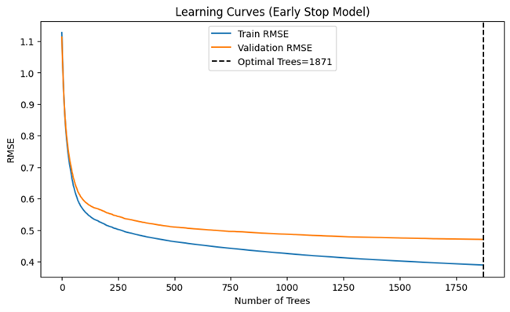  
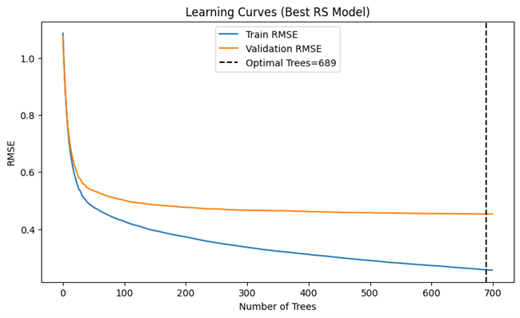  
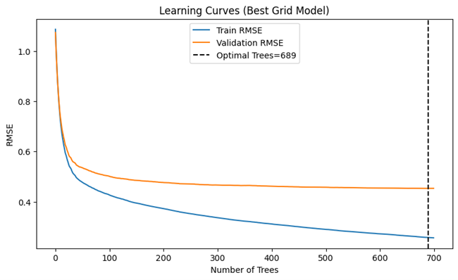

---

## 📉 Residual Diagnostics

### Validation Residuals
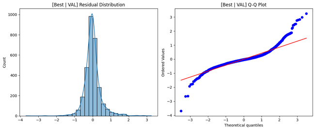

### Test Residuals
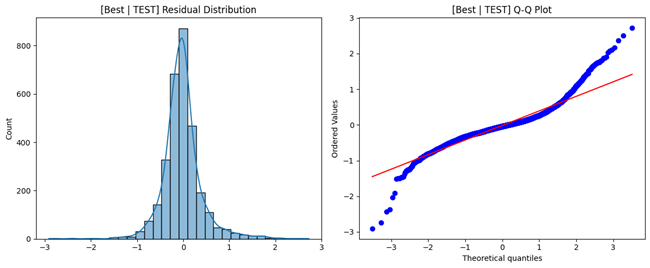

---

## 🔍 Prediction Fit

### Validation Set
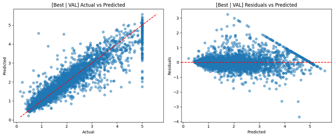

### Test Set
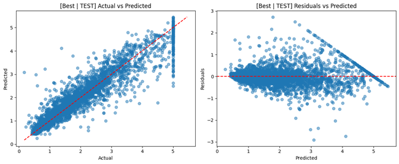

---

## 🌿 Feature Importance
Top features from the best-tuned model:  
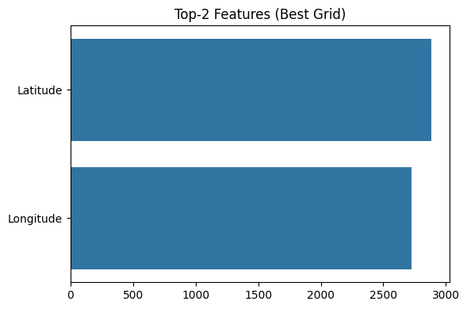

---

## 📊 Partial Dependence & ICE Plots
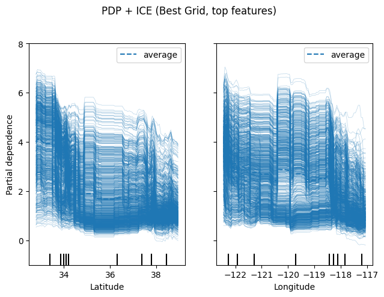  
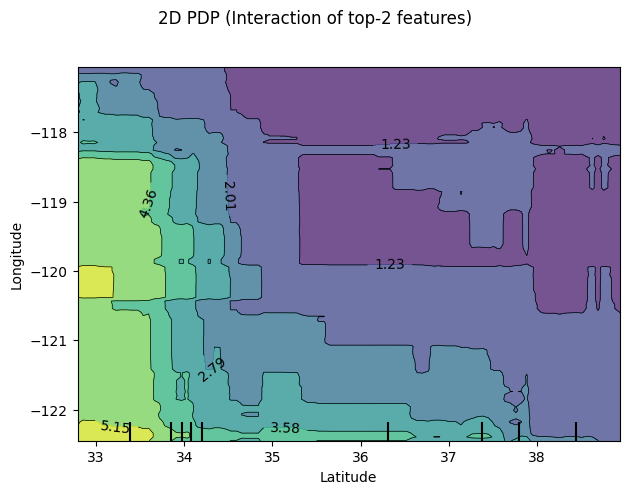

---

## 💡 SHAP Explainability

### Global SHAP
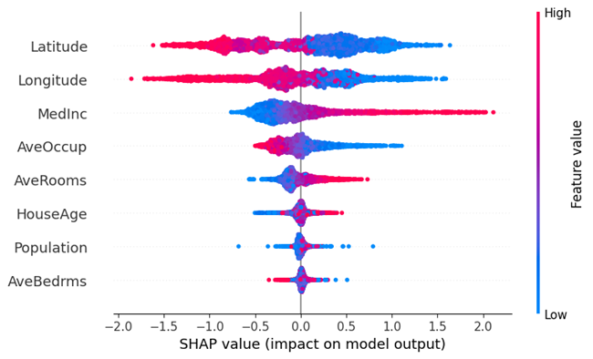

### Local SHAP
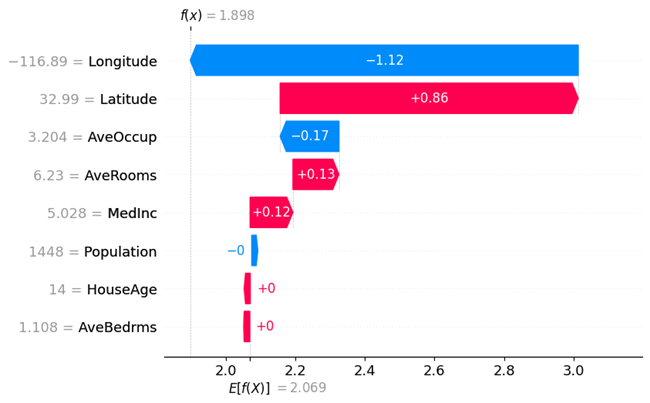

---

## 🧩 Insights
- Early stopping stabilized model training at **~1871 trees**.  
- Random Search tuned the model near **learning_rate = 0.1, max_depth = 5, subsample = 0.8**.  
- Grid refinement produced identical performance but smoother validation residuals.  
- **Median income** and **house age** dominate predictive contribution (confirmed via SHAP).  

---

## 🔮 Future Enhancements
- Integrate **XGBoost** and **CatBoost** comparisons  
- Add **Bayesian Optimization** for auto-tuning  
- Implement **cross-validated SHAP dashboards**  
- Extend to **multi-output regression tasks**

---

## 👨‍💻 Author
**Shubham Singh**

---

## 📜 License
MIT License
