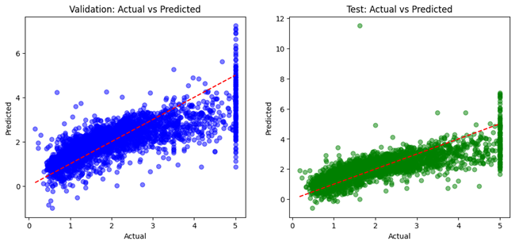
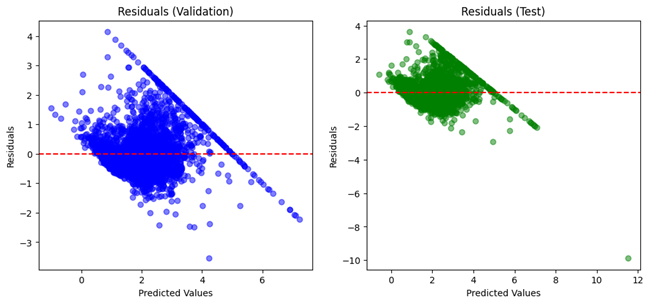

# Linear Regression Baseline

> Implementation notes for the code and artifacts currently stored in this directory.

[](./LICENSE)

## Overview

A baseline regression implementation comparing holdout and five-fold cross-validation metrics with actual-versus-predicted, residual and metric-comparison plots.

## Data and assumptions

Scikit-learn California Housing dataset (`fetch_california_housing`); the first fetch may require an internet connection.

## Implemented workflow

- Ordinary least squares via `LinearRegression`
- 70/15/15 train/validation/test split
- Five-fold shuffled KFold evaluation
- MSE, RMSE, MAE, R² and adjusted R²

## Evaluation and artifacts

A simple reference model for the other California Housing regression experiments.

The following result files are present in this directory (paths checked against the repository tree):

- [metric comparison.png](./metric%20comparison.png)
- [predictions.png](./predictions.png)
- [residuals.png](./residuals.png)
- [residual distribution.png](./residual%20distribution.png)
- [residuals CV 1st fold.png](./residuals%20CV%201st%20fold.png)

### Selected visualizations







## Run and dependencies

- Implementation: [linear_regression.py](./linear_regression.py)
- Dependencies: [requirements.txt](./requirements.txt)
```bash
pip install -r "requirements.txt"
python "linear_regression.py"
```

## Limitations and reproducibility notes

- This is a baseline fit; it does not establish causality.
- The numeric metrics in the source README are historical results and are not re-executed as part of this documentation pass.

## Author

Shubham Kumar Singh

## License

Licensed under the MIT License. See [`./LICENSE`](./LICENSE). The complete license text is included below for portability.

```text
MIT License

Copyright (c) 2026 Shubham Kumar Singh

Permission is hereby granted, free of charge, to any person obtaining a copy
of this software and associated documentation files (the "Software"), to deal
in the Software without restriction, including without limitation the rights
to use, copy, modify, merge, publish, distribute, sublicense, and/or sell
copies of the Software, and to permit persons to whom the Software is
furnished to do so, subject to the following conditions:

The above copyright notice and this permission notice shall be included in all
copies or substantial portions of the Software.

THE SOFTWARE IS PROVIDED "AS IS", WITHOUT WARRANTY OF ANY KIND, EXPRESS OR
IMPLIED, INCLUDING BUT NOT LIMITED TO THE WARRANTIES OF MERCHANTABILITY,
FITNESS FOR A PARTICULAR PURPOSE AND NONINFRINGEMENT. IN NO EVENT SHALL THE
AUTHORS OR COPYRIGHT HOLDERS BE LIABLE FOR ANY CLAIM, DAMAGES OR OTHER
LIABILITY, WHETHER IN AN ACTION OF CONTRACT, TORT OR OTHERWISE, ARISING FROM,
OUT OF OR IN CONNECTION WITH THE SOFTWARE OR THE USE OR OTHER DEALINGS IN THE
SOFTWARE.
```
