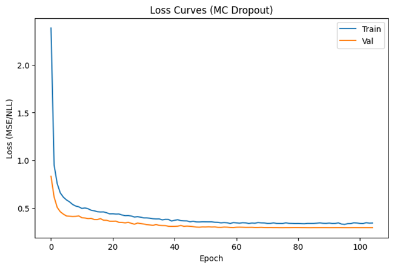
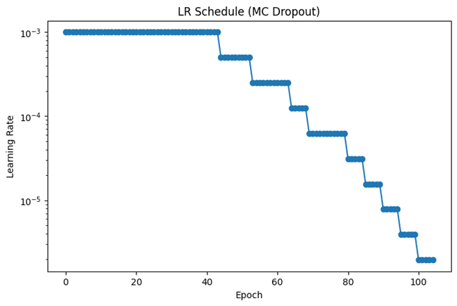
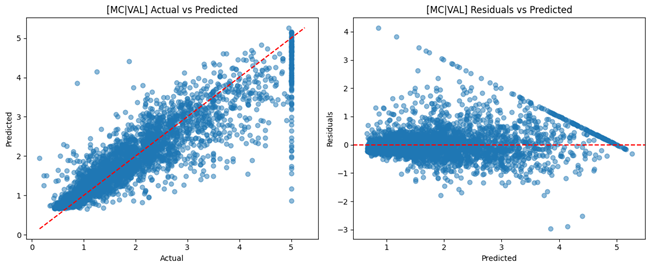
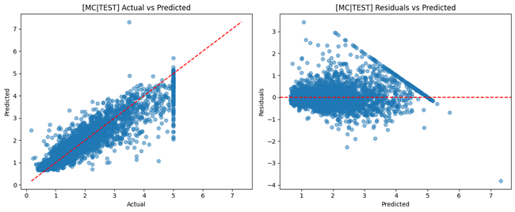

# Neural Network Regression with Uncertainty

> Implementation notes for the code and artifacts currently stored in this directory.

[](./LICENSE)

## Overview

A Keras regression experiment designed to compare point prediction and uncertainty-oriented neural approaches, with mixed precision when hardware supports it.

## Data and assumptions

Scikit-learn California Housing dataset; first download may require network access.

## Implemented workflow

- Dense neural-network regression
- Monte Carlo dropout for an epistemic-uncertainty approximation
- Heteroscedastic prediction for input-dependent aleatoric uncertainty
- Train/validation/test evaluation
- MSE, RMSE, MAE, R², adjusted R² and residual analysis

## Evaluation and artifacts

The stored visual artifacts cover learning-rate/training behavior, fit quality and residual diagnostics.

The following result files are present in this directory (paths checked against the repository tree):

- [LosscurveMCdropout.png](./LosscurveMCdropout.png)
- [LRscheduleMCdropout.png](./LRscheduleMCdropout.png)
- [actualvspredicted_validation.png](./actualvspredicted_validation.png)
- [actualvspredicted_test.png](./actualvspredicted_test.png)
- [residual_validation.png](./residual_validation.png)
- [residual_test.png](./residual_test.png)

### Selected visualizations









## Run and dependencies

- Implementation: [NNcontinuos_output.py](./NNcontinuos_output.py)
- Dependencies: [requirements.txt](./requirements.txt)
```bash
pip install -r "requirements.txt"
# Then run the script in a notebook-compatible environment as described above.
```

## Limitations and reproducibility notes

- The script contains IPython package-install magic and should be run in a notebook-compatible environment as-is.
- GPU and mixed-precision behavior depend on compatible TensorFlow, CUDA and device support.
- Uncertainty estimates are model-dependent and should not be interpreted as calibrated coverage guarantees without further validation.

## Author

Shubham Kumar Singh

## License

Licensed under the MIT License. See [`./LICENSE`](./LICENSE). The complete license text is included below for portability.

```text
MIT License

Copyright (c) 2026 Shubham Kumar Singh

Permission is hereby granted, free of charge, to any person obtaining a copy
of this software and associated documentation files (the "Software"), to deal
in the Software without restriction, including without limitation the rights
to use, copy, modify, merge, publish, distribute, sublicense, and/or sell
copies of the Software, and to permit persons to whom the Software is
furnished to do so, subject to the following conditions:

The above copyright notice and this permission notice shall be included in all
copies or substantial portions of the Software.

THE SOFTWARE IS PROVIDED "AS IS", WITHOUT WARRANTY OF ANY KIND, EXPRESS OR
IMPLIED, INCLUDING BUT NOT LIMITED TO THE WARRANTIES OF MERCHANTABILITY,
FITNESS FOR A PARTICULAR PURPOSE AND NONINFRINGEMENT. IN NO EVENT SHALL THE
AUTHORS OR COPYRIGHT HOLDERS BE LIABLE FOR ANY CLAIM, DAMAGES OR OTHER
LIABILITY, WHETHER IN AN ACTION OF CONTRACT, TORT OR OTHERWISE, ARISING FROM,
OUT OF OR IN CONNECTION WITH THE SOFTWARE OR THE USE OR OTHER DEALINGS IN THE
SOFTWARE.
```
