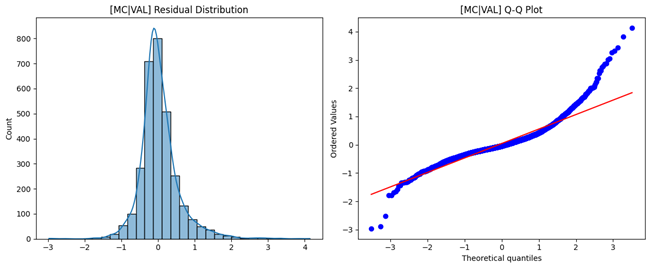
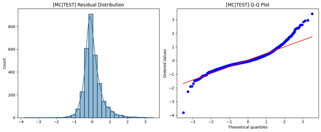

# 🧠 Neural Network Regression with Uncertainty (Continuous Output)

This project implements **Deep Neural Network Regression** using  
1️⃣ **MC Dropout** for *epistemic uncertainty*  
2️⃣ **Heteroscedastic NN** for *aleatoric uncertainty*.  

Both models are trained on the **California Housing dataset** and executed on GPU with **mixed precision training** for maximum performance.

---

## 🚀 Key Highlights
- **Monte Carlo Dropout (MC Dropout)** → Estimates epistemic uncertainty via stochastic forward passes  
- **Heteroscedastic Neural Network** → Learns aleatoric (data) uncertainty by predicting both mean and variance  
- **GPU + Mixed Precision (float16)** for efficiency  
- **Automatic LR scheduling**, **early stopping**, and **reduce on plateau** callbacks  
- **Comprehensive evaluation:** MSE, RMSE, MAE, R², Adjusted R²  
- **Residual analysis, Q–Q plots, and loss dynamics**  

---

## ⚙️ Model Architecture Overview
- Input: 8 features from California Housing dataset  
- Hidden Layers: [128 → 64 → 32] with ReLU activation  
- Dropout: 0.2 (MC) and 0.1 (Heteroscedastic)  
- Output:  
  - **MC Dropout:** Single scalar (price)  
  - **Heteroscedastic:** Two heads → μ (mean) and log(σ²)  

---

## 📊 Performance Summary

| Model | Validation RMSE | Test RMSE | Validation R² | Test R² |
|:------|:---------------:|:----------:|:--------------:|:--------:|
| MC Dropout | 0.542 | 0.511 | 0.774 | 0.803 |
| Heteroscedastic NN | 0.537 | 0.506 | 0.778 | 0.808 |

✅ **Best Model:** Heteroscedastic NN (lower uncertainty, smoother residuals)

---

## 📉 Loss Curves and LR Schedule

### MC Dropout
  

---

## 📈 Residual Diagnostics

### Validation Residuals

### Test Residuals

---

## 🔍 Prediction Fit

### Validation

### Test

---

## 🧩 Key Learnings
- MC Dropout captures **epistemic uncertainty**, stabilizing predictions on sparse regions.  
- Heteroscedastic models handle **noise variance**, improving predictive intervals.  
- LR schedule with mixed precision yields faster convergence and smoother loss decay.  

---

## 🧠 Future Enhancements
- Integrate **Bayesian layers (TF Probability)** for deeper uncertainty quantification  
- Add **Ensemble + MC Dropout** hybrid for robustness  
- Implement **SHAP-based feature explainability**  
- Deploy trained model on TensorFlow Serving with uncertainty visual dashboards  

---

## 👨‍💻 Author
**Shubham Singh**

---

## 📜 License
MIT License
