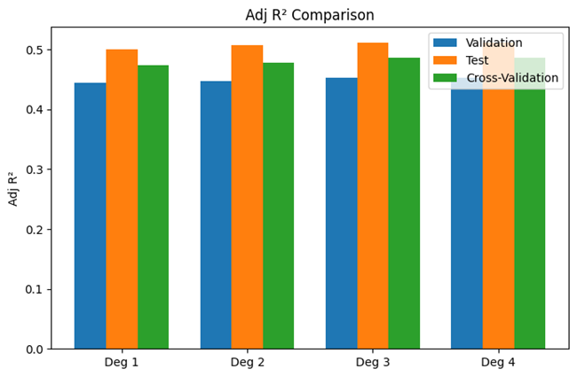
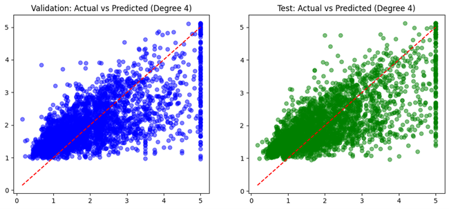

# 📘 Polynomial Regression (California Housing)

The Polynomial Regression project extends Linear Regression by modeling non-linear relationships between **median income** and **housing prices** from the **California Housing dataset**. It systematically evaluates polynomial degrees (1–4), identifies the optimal degree based on validation performance, and visualizes metrics, learning curves, and residual distributions.

---

## 🚀 Key Features
- Fits polynomial features of degree 1–4 using Scikit-learn Pipelines  
- Evaluates Validation, Test, and Cross-Validation performance  
- Metrics: MSE, RMSE, MAE, R², Adjusted R²  
- Automatically selects the best polynomial degree (based on Adjusted R²)  
- Provides comprehensive plots for interpretability  

---

## 🧰 Tech Stack
- **Framework:** Scikit-learn  
- **Dataset:** California Housing (Median Income Feature)  
- **Libraries:** NumPy, Matplotlib, Seaborn, Scikit-learn  
- **Model:** Linear Regression with PolynomialFeatures  
- **Validation:** 70/15/15 split + 5-Fold Cross-Validation  

---

## 📊 Results Summary

| Degree | Validation (R²) | Test (R²) | Cross-Validation (R²) |
|:------:|:----------------:|:----------:|:----------------------:|
| 1 | 0.445 | 0.500 | 0.473 |
| 2 | 0.448 | 0.507 | 0.478 |
| 3 | 0.453 | 0.512 | 0.486 |
| 4 | **0.453** | **0.512** | **0.486** |

✅ **Best Degree Selected (based on Validation Adjusted R²): 4**

---

## 📈 Metric Comparison

---

## 📉 Actual vs Predicted

---

## 📈 Learning Curve

---

## 📊 Residual Distribution

---

## 🔮 Future Enhancements
- Add Ridge and Lasso Polynomial Regression for regularization  
- Include model complexity vs. bias–variance analysis  
- Extend to multi-feature polynomial modeling  
- Implement degree selection via GridSearchCV  

---

## 👨‍💻 Author
**Shubham Singh**

---

## 📜 License
MIT License
