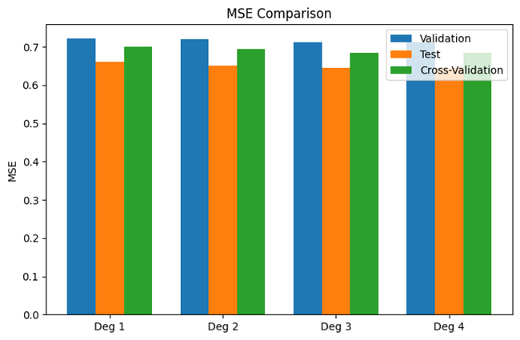
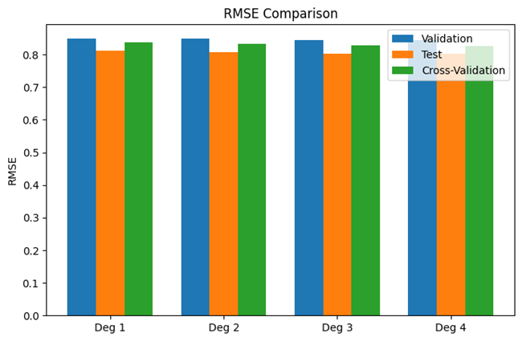
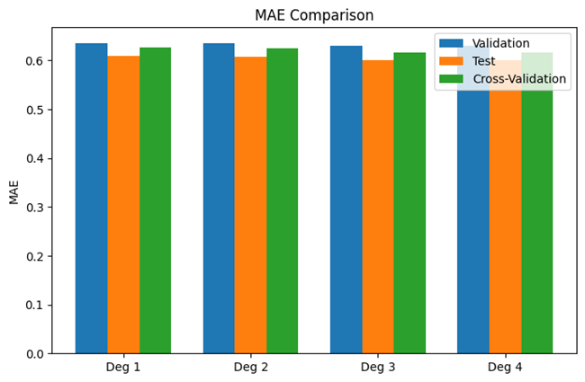
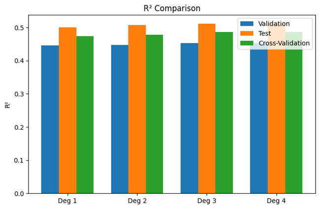

# Polynomial Regression

> Implementation notes for the code and artifacts currently stored in this directory.

[](./LICENSE)

## Overview

A single-feature polynomial regression comparison using a pipeline of feature expansion and linear regression, with degree selection and holdout/cross-validation reporting.

## Data and assumptions

Scikit-learn California Housing data. The script uses the median-income feature as the explanatory variable for the demonstration.

## Implemented workflow

- PolynomialFeatures + LinearRegression pipeline
- Candidate degrees 1 through 4
- 70/15/15 split and five-fold shuffled KFold
- MSE, RMSE, MAE, R² and adjusted R²
- Actual-versus-predicted, learning curve and residual distribution

## Evaluation and artifacts

Useful for studying nonlinear feature expansion and model-complexity trade-offs on a controlled regression setup.

The following result files are present in this directory (paths checked against the repository tree):

- [MSE.png](./MSE.png)
- [RMSE.png](./RMSE.png)
- [MAE.png](./MAE.png)
- [R2.png](./R2.png)
- [adjr2.png](./adjr2.png)
- [actualvspredicted.png](./actualvspredicted.png)
- [learning curve.png](./learning%20curve.png)
- [residual distribution.png](./residual%20distribution.png)

### Selected visualizations









## Run and dependencies

- Implementation: [polynomial_regression.py](./polynomial_regression.py)
- Dependencies: [requirements.txt](./requirements.txt)
```bash
pip install -r "requirements.txt"
python "polynomial_regression.py"
```

## Limitations and reproducibility notes

- A univariate demonstration cannot represent all available housing predictors.
- The script selects degree using validation adjusted R²; the holdout test results should be reserved for final reporting.

## Author

Shubham Kumar Singh

## License

Licensed under the MIT License. See [`./LICENSE`](./LICENSE). The complete license text is included below for portability.

```text
MIT License

Copyright (c) 2026 Shubham Kumar Singh

Permission is hereby granted, free of charge, to any person obtaining a copy
of this software and associated documentation files (the "Software"), to deal
in the Software without restriction, including without limitation the rights
to use, copy, modify, merge, publish, distribute, sublicense, and/or sell
copies of the Software, and to permit persons to whom the Software is
furnished to do so, subject to the following conditions:

The above copyright notice and this permission notice shall be included in all
copies or substantial portions of the Software.

THE SOFTWARE IS PROVIDED "AS IS", WITHOUT WARRANTY OF ANY KIND, EXPRESS OR
IMPLIED, INCLUDING BUT NOT LIMITED TO THE WARRANTIES OF MERCHANTABILITY,
FITNESS FOR A PARTICULAR PURPOSE AND NONINFRINGEMENT. IN NO EVENT SHALL THE
AUTHORS OR COPYRIGHT HOLDERS BE LIABLE FOR ANY CLAIM, DAMAGES OR OTHER
LIABILITY, WHETHER IN AN ACTION OF CONTRACT, TORT OR OTHERWISE, ARISING FROM,
OUT OF OR IN CONNECTION WITH THE SOFTWARE OR THE USE OR OTHER DEALINGS IN THE
SOFTWARE.
```
