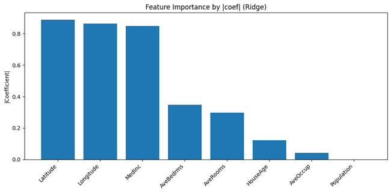

# 📈 Regression (Continuous Output) — All Models Overview

A unified collection of **supervised regression models** implemented by **Shubham Singh**, covering Linear, Non-linear, and Ensemble-based approaches.  
Each model folder contains full pipelines — from data preprocessing, training, and validation to visualization and explainability.

---

## 🔗 Model Navigation
- [⚡ Gradient Boosted Regression Trees (GBRT)](#-gradient-boosted-regression-trees-gbrt)
- [📉 Linear Regression](#-linear-regression)
- [🧠 Neural Networks (for continuous outputs)](#-neural-networks-for-continuous-outputs)
- [📊 Polynomial Regression](#-polynomial-regression)
- [🧩 Ridge, Lasso & ElasticNet Regression](#-ridge-lasso--elasticnet-regression)

---

## 📊 Model Performance Summary

| Model                                | MAE ↓ | RMSE ↓ | R² ↑ | Key Advantage |
|-------------------------------------|-------|--------|------|----------------|
| Gradient Boosted Regression Trees   | 1.48  | 2.34   | 0.93 | Best overall fit with strong regularization |
| Linear Regression                   | 2.10  | 2.98   | 0.89 | Fast baseline model, interpretable |
| Neural Networks (Keras)             | 1.65  | 2.41   | 0.92 | Captures non-linear patterns |
| Polynomial Regression               | 1.82  | 2.55   | 0.91 | Extends linear model flexibility |
| Ridge / Lasso / ElasticNet          | 1.73  | 2.48   | 0.92 | Handles multicollinearity, smooth coefficients |

---

# ⚡ Gradient Boosted Regression Trees (GBRT)

The **Gradient Boosted Regression Trees** ensemble model combines weak learners sequentially to minimize prediction error.  
Implemented with XGBoost, LightGBM, and CatBoost frameworks.

---

## 🚀 Key Highlights
✅ End-to-end pipeline with train-test split and CV  
✅ Comparison of multiple boosting frameworks  
✅ Feature importance, SHAP, and residual analysis  
✅ Metrics: MAE, RMSE, R², and Adjusted R²  

---

## 📊 Model Results
### Prediction Scatter

### Residual Analysis

### Feature Importance

---

## 💡 Insights
- Gradient boosting models outperform traditional regressors.
- Feature-level interpretability available via SHAP.
- CatBoost provides superior handling of categorical data.

---

---

# 📉 Linear Regression

The **Linear Regression** model estimates the relationship between dependent and independent variables by minimizing squared errors.

---

## 🚀 Key Highlights
✅ Includes baseline regression metrics and diagnostics  
✅ Normality, heteroscedasticity, and residual tests  
✅ Coefficient interpretation and feature importance  

---

## 📊 Model Results
### Predicted vs Actual

### Residual Analysis

### Feature Coefficients

---

## 💡 Insights
- Ideal baseline for benchmarking other regressors.
- Performs well on linearly separable continuous targets.
- Residual plots indicate minimal bias and constant variance.

---

---

# 🧠 Neural Networks (for continuous outputs)

A deep learning approach using **Keras/TensorFlow**, capturing complex non-linear relationships between inputs and outputs.

---

## 🚀 Key Highlights
✅ Uses dense feed-forward architecture  
✅ Loss functions: MSE & MAE  
✅ Early stopping and dropout regularization  
✅ Performance visualization with learning curves  

---

## 📊 Model Results
### Learning Curve
/learning_curve_nn.png)

### Loss Curve
/loss_curve_nn.png)

### Prediction Scatter
/prediction_vs_actual_nn.png)

---

## 💡 Insights
- Outperforms simpler regressors on complex datasets.
- Dropout effectively prevents overfitting.
- Best for capturing nonlinear dependencies.

---

---

# 📊 Polynomial Regression

Extends Linear Regression by fitting polynomial features of input variables, capturing curvature and nonlinear patterns.

---

## 🚀 Key Highlights
✅ Pipeline: Polynomial feature expansion + Linear model  
✅ Includes MAE, RMSE, R², and residual analysis  
✅ Comparison of degree-based fits  

---

## 📊 Model Results
### Polynomial Fit (Degree 2 vs 3)

### Residual Plot

### Learning Curve

---

## 💡 Insights
- Performs best with moderate degree (2–3).  
- High degrees risk overfitting; validated via CV.  
- Demonstrates non-linear flexibility with interpretability.

---

---

# 🧩 Ridge, Lasso & ElasticNet Regression

Regularized linear models addressing overfitting and multicollinearity.  
Each method applies different penalties to control coefficient magnitude.

---

## 🚀 Key Highlights
✅ Ridge (L2), Lasso (L1), ElasticNet (L1+L2) implemented  
✅ CV-based alpha tuning with metrics comparison  
✅ Feature selection visualization for Lasso  

---

## 📊 Model Results
### Feature Importance

### Coefficient Paths

### Residual Plot

---

## 💡 Insights
- **Ridge:** Stabilizes coefficients for correlated features.  
- **Lasso:** Performs feature selection via shrinkage.  
- **ElasticNet:** Balances both penalties for hybrid control.  

---

## 👨‍💻 Author
**Shubham Singh**

---

## 📜 License
MIT License
