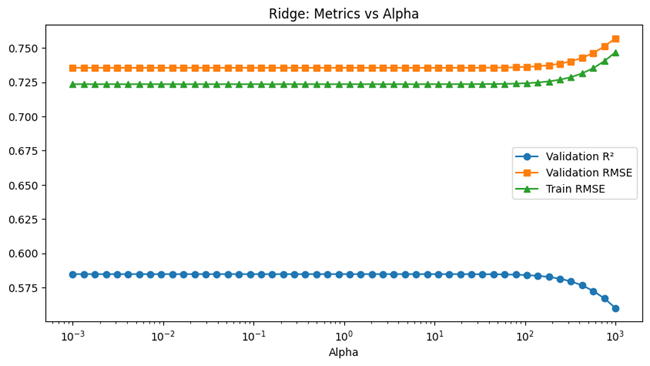
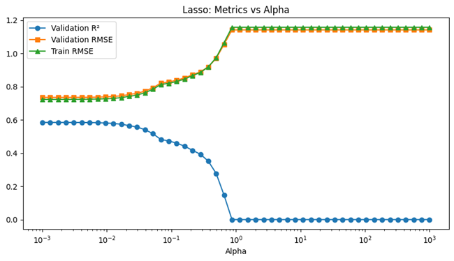
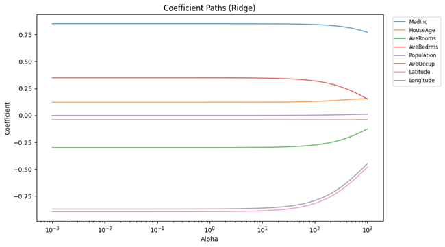
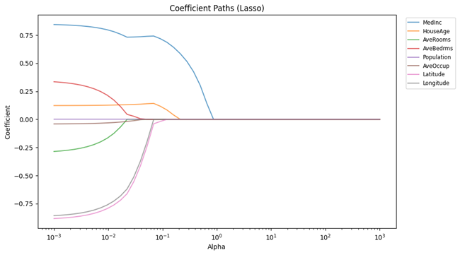
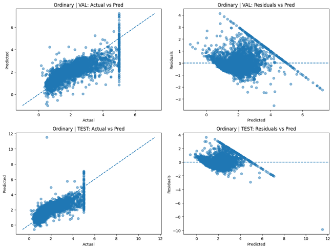
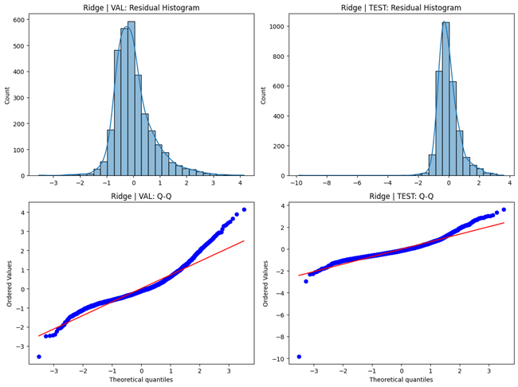
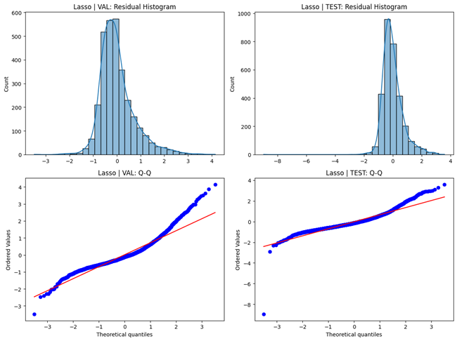

# 📘 Ridge, Lasso & ElasticNet Regression (California Housing)

This project extends linear regression through **regularization techniques** — **Ridge (L2)**, **Lasso (L1)**, and **ElasticNet (L1 + L2)** — to address overfitting and multicollinearity using the **California Housing dataset**. It evaluates multiple regularization strengths, visualizes coefficient paths, and compares metrics to identify the optimal bias–variance tradeoff.

---

## 🚀 Key Features
- Comparative study of **OLS**, **Ridge**, **Lasso**, and **ElasticNet**  
- Automatic alpha tuning using **RidgeCV**, **LassoCV**, and **ElasticNetCV**  
- Full metric reporting (MSE, RMSE, MAE, R², Adjusted R²)  
- Visual exploration of coefficient shrinkage and validation curves  
- ElasticNet heatmap across α–L1 grid  
- Comprehensive diagnostics: residuals, Q–Q plots, feature importances  

---

## 🧰 Tech Stack
- **Framework:** Scikit-learn  
- **Dataset:** California Housing  
- **Regularization Models:** Ridge, Lasso, ElasticNet  
- **Tools:** NumPy, Pandas, Seaborn, Matplotlib, SciPy  

---

## 📊 Results Summary

| Model | Validation R² | Test R² | Adj. R² | Best α | Effective p |
|:------|:--------------:|:--------:|:--------:|:-------:|:-------------:|
| Ordinary | 0.5848 | 0.6066 | 0.6055 | – | 8 |
| Ridge | **0.5848** | **0.6068** | 0.6058 | 6.25 | 8 |
| Lasso | 0.5845 | 0.6101 | 0.6092 | 0.0031 | 7 |
| ElasticNet | 0.5845 | 0.6101 | 0.6092 | 0.0031 | 7 |

✅ **Best Model (Validation R²): Ridge Regression (α ≈ 6.25)**  

---

## 📈 Metric Comparison
  
  
  

---

## 📉 Validation Curves vs Alpha
  
  

---

## 🔁 Coefficient Paths
  
  

---

## 🌡️ ElasticNet Validation R² Heatmap
  

---

## 🔍 Model Diagnostics

### Ordinary Least Squares
  
  

### Ridge Regression
  
  

### Lasso Regression
  
  

### ElasticNet
  
  

---

## 🧩 Feature Importance Visualization

### OLS vs Ridge vs Lasso vs ElasticNet
  
  
  
  

---

## 🔮 Future Enhancements
- Implement **Bayesian Ridge Regression**  
- Introduce **Cross-Validated ElasticNet GridSearch**  
- Add **learning curve plots** for all models  
- Integrate **model persistence** via joblib/pickle  

---

## 👨‍💻 Author
**Shubham Singh**

---

## 📜 License
MIT License
