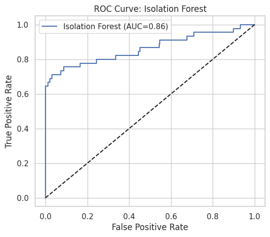
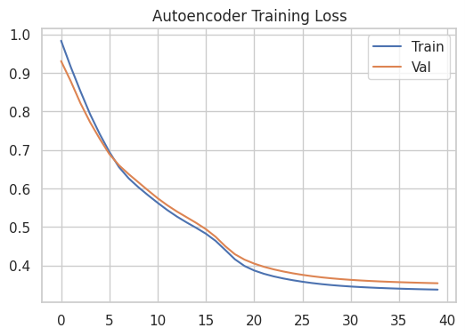
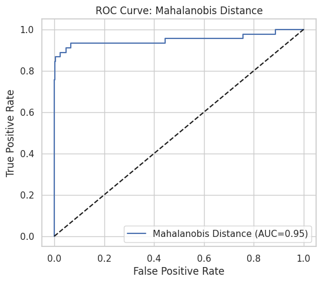

# Unsupervised Anomaly Detection Comparison

> Implementation notes for the code and artifacts currently stored in this directory.

[](./LICENSE)

## Overview

A controlled synthetic-data experiment that compares classical distance/statistical detectors, a one-class boundary model and neural reconstruction error.

## Data and assumptions

Synthetic classification-shaped data with injected outliers, generated in the script with a fixed seed.

## Implemented workflow

- Isolation Forest
- One-Class SVM (RBF)
- Autoencoder reconstruction error
- Z-score baseline
- Mahalanobis distance
- ROC-AUC, PR-AUC, F1, threshold tuning and score distributions

## Evaluation and artifacts

Treat the included metrics as a controlled synthetic benchmark and a starting point for designing anomaly evaluation on real data.

The following result files are present in this directory (paths checked against the repository tree):

- [roc_curve_isolation_forest.png](./roc_curve_isolation_forest.png)
- [precission_recall_curve_isolation_forest.png](./precission_recall_curve_isolation_forest.png)
- [autoencoder_training_loss.png](./autoencoder_training_loss.png)
- [roc_curve_mahalanobis_distance.png](./roc_curve_mahalanobis_distance.png)
- [precision_recall_curve_mahalanobis_distance.png](./precision_recall_curve_mahalanobis_distance.png)
- [model_comparison_by_auc_roc.png](./model_comparison_by_auc_roc.png)
- [model_comparison_by_f1.png](./model_comparison_by_f1.png)

### Selected visualizations








## Run and dependencies

- Implementation: [anomolity detection.py](./anomolity%20detection.py)
- Dependencies: [requirements.txt](./requirements.txt)
```bash
pip install -r "requirements.txt"
# Then run the script in a notebook-compatible environment as described above.
```

## Limitations and reproducibility notes

- Because anomalies are injected into generated data, results do not directly establish performance on real operational anomaly data.
- The script contains IPython package-install magic; use a notebook-compatible environment as written or remove the magic line after installing dependencies.
- Thresholds should be chosen using a clearly separated validation set in deployment use.

## Author

Shubham Kumar Singh

## License

Licensed under the MIT License. See [`./LICENSE`](./LICENSE). The complete license text is included below for portability.

```text
MIT License

Copyright (c) 2026 Shubham Kumar Singh

Permission is hereby granted, free of charge, to any person obtaining a copy
of this software and associated documentation files (the "Software"), to deal
in the Software without restriction, including without limitation the rights
to use, copy, modify, merge, publish, distribute, sublicense, and/or sell
copies of the Software, and to permit persons to whom the Software is
furnished to do so, subject to the following conditions:

The above copyright notice and this permission notice shall be included in all
copies or substantial portions of the Software.

THE SOFTWARE IS PROVIDED "AS IS", WITHOUT WARRANTY OF ANY KIND, EXPRESS OR
IMPLIED, INCLUDING BUT NOT LIMITED TO THE WARRANTIES OF MERCHANTABILITY,
FITNESS FOR A PARTICULAR PURPOSE AND NONINFRINGEMENT. IN NO EVENT SHALL THE
AUTHORS OR COPYRIGHT HOLDERS BE LIABLE FOR ANY CLAIM, DAMAGES OR OTHER
LIABILITY, WHETHER IN AN ACTION OF CONTRACT, TORT OR OTHERWISE, ARISING FROM,
OUT OF OR IN CONNECTION WITH THE SOFTWARE OR THE USE OR OTHER DEALINGS IN THE
SOFTWARE.
```
