# 🧠 Anomaly Detection — Isolation Forest, One-Class SVM, Autoencoder & Statistical Baselines

This project demonstrates **unsupervised anomaly detection** using classical and neural approaches on synthetic data with injected outliers.  
It includes complete visual analysis — ROC, PR, Threshold Tuning, and Comparative Evaluation.

---

## 🚀 Key Highlights
✅ Implements five anomaly-detection techniques:
- **Isolation Forest**
- **One-Class SVM (RBF)**
- **Autoencoder (Neural Reconstruction Error)**
- **Z-Score Baseline**
- **Mahalanobis Distance**

✅ Synthetic dataset generation with injected anomalies  
✅ Unified evaluation framework for AUC-ROC, AUC-PR, and F1  
✅ Comprehensive visualization of model thresholds and distributions  
✅ PCA-based 2D visualization for Autoencoder and Isolation Forest  
✅ Comparative summary by AUC and F1

---

## ⚙️ Models & Results Overview

| Model | AUC-ROC | AUC-PR | F1 | Notes |
|--------|----------|--------|----|--------|
| Mahalanobis Distance | **0.9503** | **0.9056** | **0.9048** | Most stable with low variance |
| Autoencoder Reconstruction Error | 0.9234 | 0.7728 | 0.7381 | Learns deep nonlinear structure |
| One-Class SVM | 0.8991 | 0.7696 | 0.7381 | Kernel-based decision boundary |
| Isolation Forest | 0.8629 | 0.7324 | 0.7143 | Fast, tree-based ensemble |
| Z-Score Baseline | 0.8593 | 0.7254 | 0.7143 | Simple statistical cutoff |

---

## 🌲 Isolation Forest

### ROC Curve  

### Precision-Recall Curve  

### Threshold Optimization  
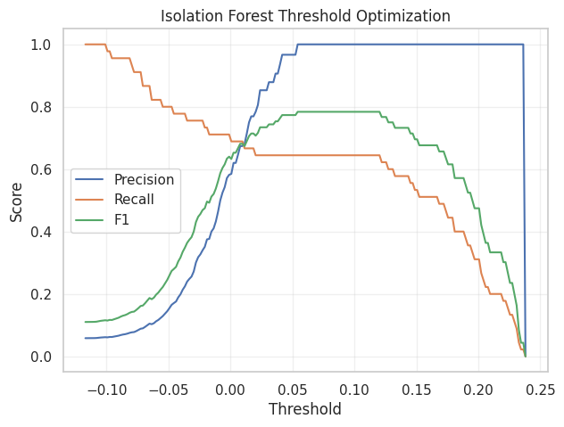

### Score Distribution  
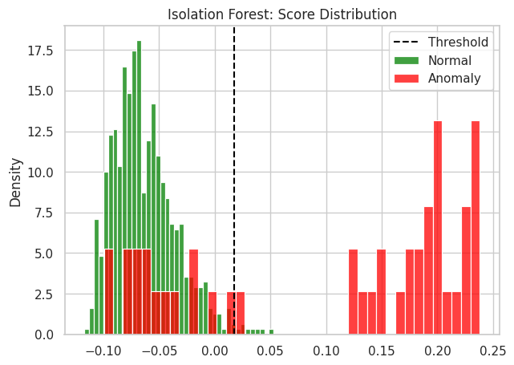

---

## ⚙️ One-Class SVM

### ROC Curve  
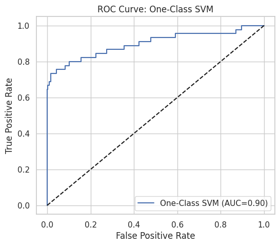

### Precision-Recall Curve  
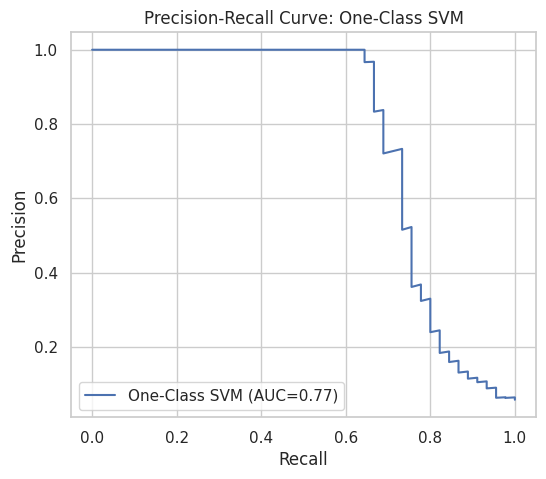

### Score Distribution  
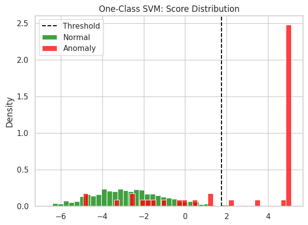

---

## 🧩 Autoencoder (Neural Network)

### Training Loss  

### ROC Curve  
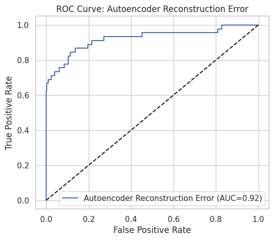

### Precision-Recall Curve  
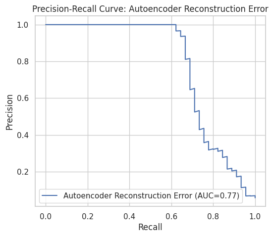

### Threshold Optimization  
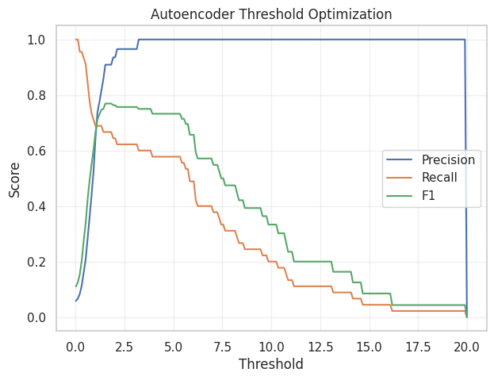

### Score Distribution  
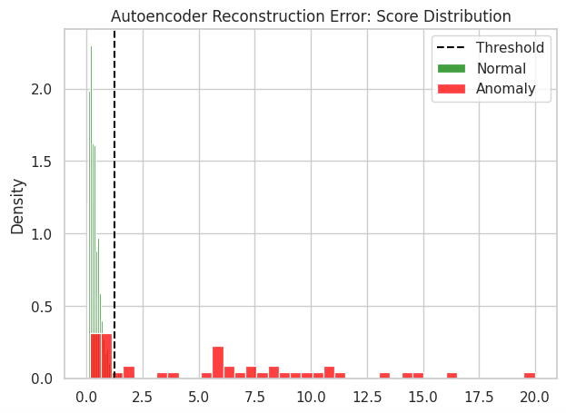

---

## 📊 Statistical Baselines

### Z-Score Baseline  
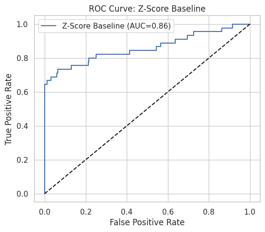  
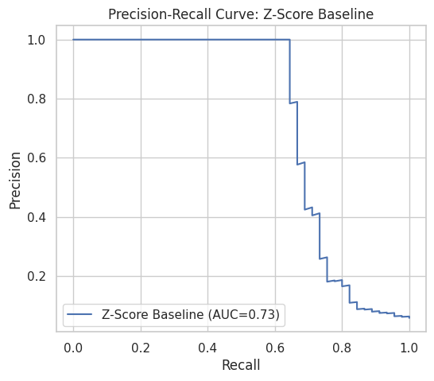  
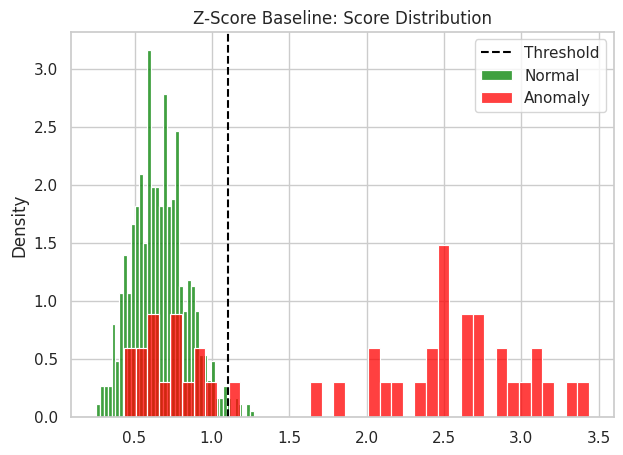

### Mahalanobis Distance  
  
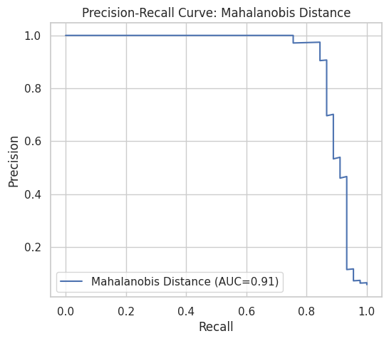  
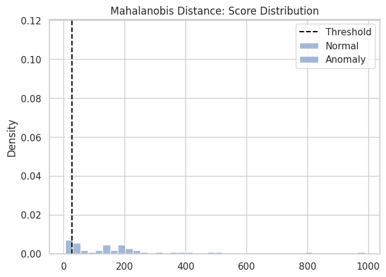

---

## 📈 Comparative Evaluation

### AUC-ROC Comparison  
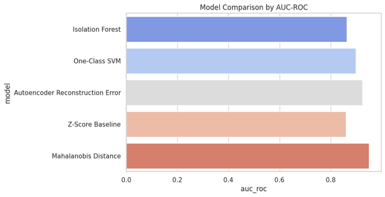

### F1 Comparison  
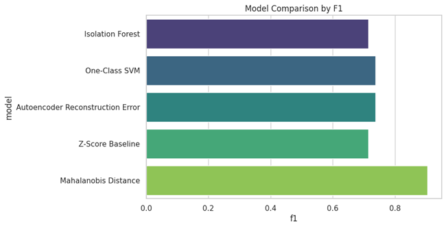

---

## 🧮 Key Insights

- **Mahalanobis Distance** achieved the highest overall performance (AUC ≈ 0.95, F1 ≈ 0.90).  
- **Autoencoder** captured nonlinear patterns well, competitive with SVM.  
- **Z-Score** remains a strong baseline for high-dimensional data.  
- Ensemble and neural methods outperform classical baselines when data contain complex dependencies.  

---

## 🔮 Future Enhancements
- Integrate **Variational Autoencoder (VAE)** and **Deep SVDD** for richer representation learning  
- Use **t-SNE or UMAP** for high-dimensional projection  
- Add **real-world datasets** like KDD99 or NAB for evaluation  

---

## 👨‍💻 Author
**Shubham Singh**

---

## 📜 License
MIT License
