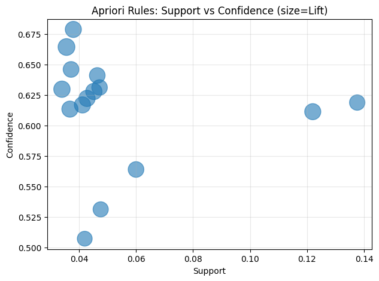
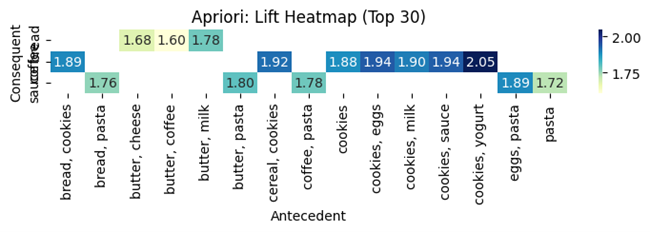
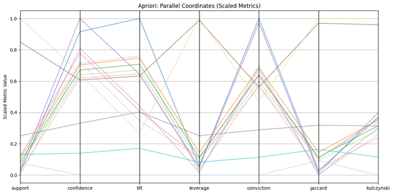
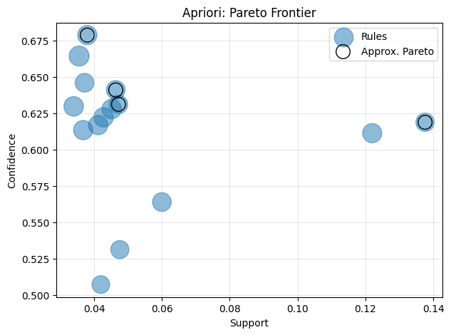

# Association Rule Learning: Apriori, FP-Growth and Eclat

> Implementation notes for the code and artifacts currently stored in this directory.

[](./LICENSE)

## Overview

A market-basket analysis experiment that mines frequent itemsets and association rules, computes interestingness measures, prunes redundant rules and compares behavior on held-out synthetic transactions.

## Data and assumptions

A small hand-written example and a larger synthetic transaction generator (2,500 generated baskets) with co-occurrence structure encoded in the generator.

## Implemented workflow

- Apriori and FP-Growth through mlxtend
- Custom vertical-format Eclat implementation
- Support, confidence, lift, leverage, conviction, Jaccard and Kulczynski
- Redundancy pruning, threshold sweeps and train/test generalization checks
- CSV exports and network/heatmap/parallel-coordinate/Pareto visuals

## Evaluation and artifacts

This directory is mainly a reproducible method demonstration; replace the synthetic transactions with a documented real transaction source before drawing business conclusions.

The following result files are present in this directory (paths checked against the repository tree):

- [apriori_rules_support_vs_confidence.png](./apriori_rules_support_vs_confidence.png)
- [apriori_lift_heatmap.png](./apriori_lift_heatmap.png)
- [apriori_parallel_coordinates.png](./apriori_parallel_coordinates.png)
- [apriori_pareto_frontier.png](./apriori_pareto_frontier.png)
- [apriori_rule_network_top40.png](./apriori_rule_network_top40.png)
- [generalization_confidence_train_vs_test.png](./generalization_confidence_train_vs_test.png)
- [generalization_lift_train_vs_test.png](./generalization_lift_train_vs_test.png)

### Selected visualizations









## Run and dependencies

- Implementation: [association rule learning.py](./association%20rule%20learning.py)
- Dependencies: [requirements.txt](./requirements.txt)
```bash
pip install -r "requirements.txt"
# Then run the script in a notebook-compatible environment as described above.
```

## Limitations and reproducibility notes

- Association is not causation. The synthetic generator builds in co-occurrence structure, so benchmark results should not be described as evidence about a real retailer.
- The script contains IPython package-install magic; run it notebook-style or remove the magic after installing requirements.

## Author

Shubham Kumar Singh

## License

Licensed under the MIT License. See [`./LICENSE`](./LICENSE). The complete license text is included below for portability.

```text
MIT License

Copyright (c) 2026 Shubham Kumar Singh

Permission is hereby granted, free of charge, to any person obtaining a copy
of this software and associated documentation files (the "Software"), to deal
in the Software without restriction, including without limitation the rights
to use, copy, modify, merge, publish, distribute, sublicense, and/or sell
copies of the Software, and to permit persons to whom the Software is
furnished to do so, subject to the following conditions:

The above copyright notice and this permission notice shall be included in all
copies or substantial portions of the Software.

THE SOFTWARE IS PROVIDED "AS IS", WITHOUT WARRANTY OF ANY KIND, EXPRESS OR
IMPLIED, INCLUDING BUT NOT LIMITED TO THE WARRANTIES OF MERCHANTABILITY,
FITNESS FOR A PARTICULAR PURPOSE AND NONINFRINGEMENT. IN NO EVENT SHALL THE
AUTHORS OR COPYRIGHT HOLDERS BE LIABLE FOR ANY CLAIM, DAMAGES OR OTHER
LIABILITY, WHETHER IN AN ACTION OF CONTRACT, TORT OR OTHERWISE, ARISING FROM,
OUT OF OR IN CONNECTION WITH THE SOFTWARE OR THE USE OR OTHER DEALINGS IN THE
SOFTWARE.
```
