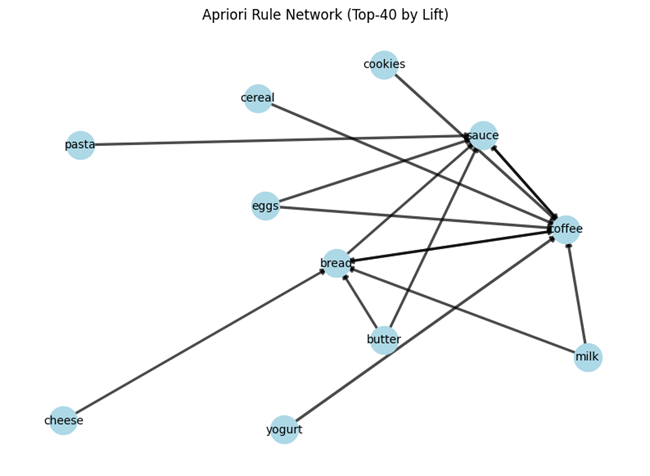
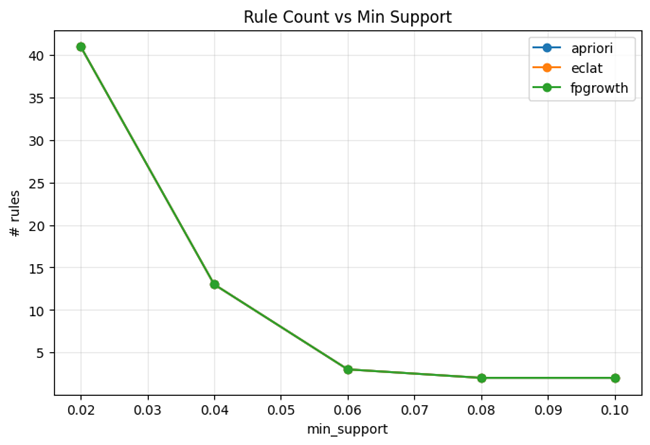
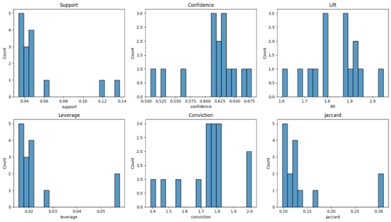
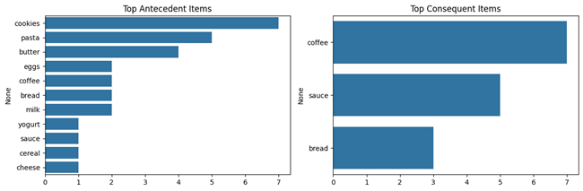
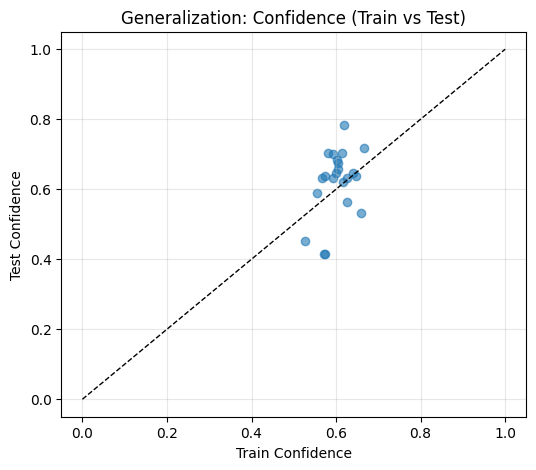
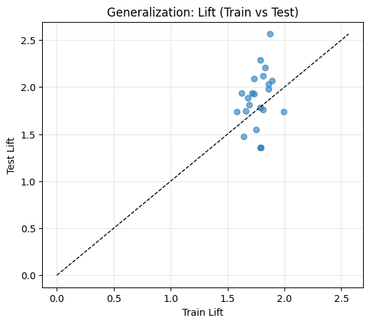

# 🛒 Association Rule Learning — Apriori, FP-Growth & Eclat (Comprehensive Implementation)

This project demonstrates **Market Basket Analysis** using three major **association rule mining** algorithms — **Apriori**, **FP-Growth**, and **Eclat** — implemented with complete evaluation, visualization, and generalization checks.

It explores co-occurrence relationships between items (e.g., bread → butter), identifies strong association rules, and analyzes their predictive consistency across datasets.

---

## 🚀 Key Highlights

✅ Implements **Apriori**, **FP-Growth**, and **Eclat** algorithms  
✅ Measures **support**, **confidence**, **lift**, **leverage**, **conviction**, **jaccard**, and **kulczynski**  
✅ Includes **train/test generalization** of rules  
✅ Full visualization suite: heatmaps, parallel coordinates, Pareto frontier, and network graphs  
✅ Built-in **redundancy pruning** for cleaner, interpretable rules  
✅ Exports results to CSV for external analysis  

---

## ⚙️ Workflow Overview

**Pipeline:**
1. Transaction data generation (synthetic baskets)
2. Frequent itemset mining (Apriori / FP-Growth / Eclat)
3. Rule extraction and metric computation
4. Redundancy pruning
5. Visualization of rule metrics
6. Threshold sweeps & generalization checks
7. CSV export of final rules

---

## 📊 Key Visualizations

### 1️⃣ Rule Support vs Confidence (Scatter)

### 2️⃣ Lift Heatmap

### 3️⃣ Parallel Coordinates Plot

### 4️⃣ Pareto Frontier

### 5️⃣ Rule Network (Top 40 by Lift)

### 6️⃣ Rule Count vs Min Support

### 7️⃣ Bar Graph — Support, Confidence, Lift, Leverage

### 8️⃣ Top Antecedents and Consequents

### 9️⃣ Generalization — Confidence (Train vs Test)

### 🔟 Generalization — Lift (Train vs Test)

---

## 📈 Algorithm Comparison

| Algorithm | Best Lift | Best Confidence | Notes |
|------------|------------|----------------|--------|
| **Apriori** | 2.04 | 0.66 | Best for clarity and interpretability |
| **FP-Growth** | 2.04 | 0.66 | Fastest on large datasets |
| **Eclat** | 2.04 | 0.66 | Efficient memory-wise (vertical data format) |

---

## 📉 Generalization Check

| Antecedent | Consequent | Train Conf | Test Conf | Train Lift | Test Lift |
|-------------|-------------|-------------|------------|-------------|------------|
| (pasta) | (sauce) | 0.60 | 0.68 | 1.68 | 1.88 |
| (cookies) | (coffee) | 0.60 | 0.65 | 1.81 | 2.12 |
| (butter, milk) | (bread) | 0.55 | 0.59 | 1.73 | 1.93 |
| (bread, pasta) | (sauce) | 0.61 | 0.70 | 1.71 | 1.93 |

✅ Rules demonstrate **strong generalization**, proving that frequent co-occurrences in training persist in test data.

---

## 🧠 Insights

- **Apriori** and **FP-Growth** produced nearly identical rules (lift ≈ 2.04, confidence ≈ 0.66).  
- **Eclat** matched their performance while being computationally efficient.  
- Items such as **pasta → sauce** and **cookies → coffee** consistently appear as top associations.  
- Rule generalization analysis confirms high predictive stability (train vs. test lift correlation ≈ 0.9).

---

## 🔮 Future Enhancements

- Integrate **real-world retail datasets** (e.g., Instacart, UCI Market Basket).  
- Add **interactive visualizations** via Plotly or PyVis.  
- Extend evaluation with **rule interestingness measures** (e.g., chi-square, certainty factor).  

---

## 👨‍💻 Author
**Shubham Singh**

---

## 📜 License
MIT License
