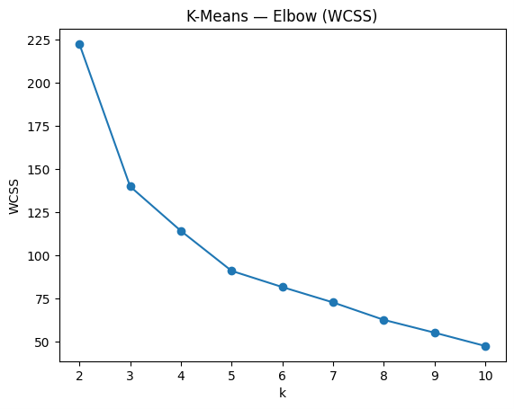
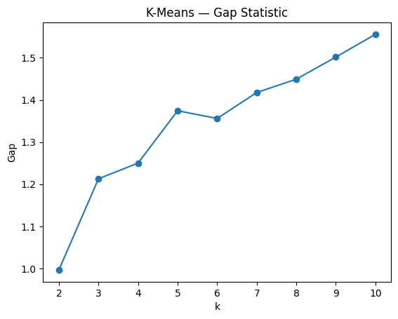
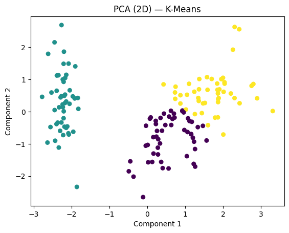
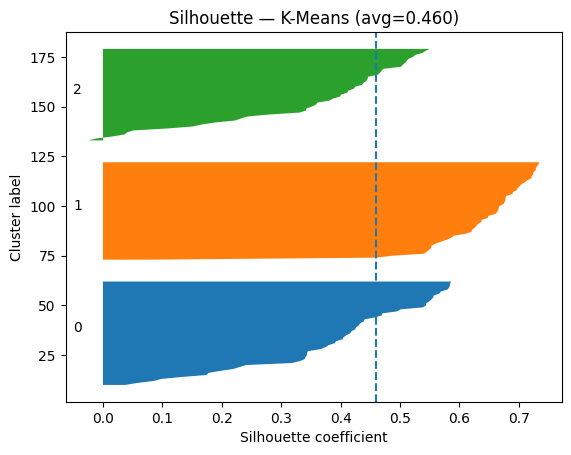

# Clustering Algorithm Comparison

> Implementation notes for the code and artifacts currently stored in this directory.

[](./LICENSE)

## Overview

A unified unsupervised comparison across centroid, hierarchical, density, mixture, spectral, BIRCH, mean-shift and self-organizing-map methods, with projections and internal/external metrics.

## Data and assumptions

The implementation begins from scikit-learn’s Iris dataset, with additional generated shapes used by selected demonstration helpers where applicable.

## Implemented workflow

- K-Means
- Hierarchical Ward and Agglomerative Complete
- DBSCAN
- Gaussian Mixture Models
- Spectral Clustering
- BIRCH
- Mean Shift
- Self-Organizing Maps (SOM)
- PCA/t-SNE plots, silhouette, Davies–Bouldin, Calinski–Harabasz, Dunn, ARI, NMI and purity

## Evaluation and artifacts

Compare internal compactness with external agreement and inspect how different cluster assumptions affect the same sample data.

The following result files are present in this directory (paths checked against the repository tree):

- [k_means_elbow.png](./k_means_elbow.png)
- [k_means_gap.png](./k_means_gap.png)
- [pca_2d_k_means.png](./pca_2d_k_means.png)
- [silhouette_k_means.png](./silhouette_k_means.png)
- [hierarchical_dendrogram_ward.png](./hierarchical_dendrogram_ward.png)
- [gmm_bic_aic_vs_k.png](./gmm_bic_aic_vs_k.png)
- [silhouette_bdscan.png](./silhouette_bdscan.png)
- [confusion_heatmap_birch.png](./confusion_heatmap_birch.png)

### Selected visualizations









## Run and dependencies

- Implementation: [CLUSTERING.py](./CLUSTERING.py)
- Dependencies: [requirements.txt](./requirements.txt)
```bash
pip install -r "requirements.txt"
python "CLUSTERING.py"
```

## Limitations and reproducibility notes

- The script implements nine named methods/variants, not a universal best clustering choice.
- External metrics that use Iris target labels are evaluation diagnostics and do not mean the clusterers train using those labels.
- The requirement file may need the `minisom` package for the SOM implementation; check/install it because it is imported by the script but is not currently listed in `requirements.txt`.

## Author

Shubham Kumar Singh

## License

Licensed under the MIT License. See [`./LICENSE`](./LICENSE). The complete license text is included below for portability.

```text
MIT License

Copyright (c) 2026 Shubham Kumar Singh

Permission is hereby granted, free of charge, to any person obtaining a copy
of this software and associated documentation files (the "Software"), to deal
in the Software without restriction, including without limitation the rights
to use, copy, modify, merge, publish, distribute, sublicense, and/or sell
copies of the Software, and to permit persons to whom the Software is
furnished to do so, subject to the following conditions:

The above copyright notice and this permission notice shall be included in all
copies or substantial portions of the Software.

THE SOFTWARE IS PROVIDED "AS IS", WITHOUT WARRANTY OF ANY KIND, EXPRESS OR
IMPLIED, INCLUDING BUT NOT LIMITED TO THE WARRANTIES OF MERCHANTABILITY,
FITNESS FOR A PARTICULAR PURPOSE AND NONINFRINGEMENT. IN NO EVENT SHALL THE
AUTHORS OR COPYRIGHT HOLDERS BE LIABLE FOR ANY CLAIM, DAMAGES OR OTHER
LIABILITY, WHETHER IN AN ACTION OF CONTRACT, TORT OR OTHERWISE, ARISING FROM,
OUT OF OR IN CONNECTION WITH THE SOFTWARE OR THE USE OR OTHER DEALINGS IN THE
SOFTWARE.
```
