# 🧩 Comprehensive Dimensionality Reduction — PCA, t-SNE, UMAP, Autoencoder, VAE, and More

This project implements **13 dimensionality reduction techniques** (linear, manifold, and neural) and evaluates them on the **Iris dataset** using both **internal** and **external metrics**.  
It provides a full comparison suite with **2D visualizations**, **reconstruction errors**, **trustworthiness analysis**, and **confusion heatmaps** across methods.

---

## 🚀 Key Highlights
✅ 13 algorithms in one unified script  
✅ Comparison across linear, manifold, and neural techniques  
✅ Evaluation on clustering performance (Silhouette, ARI, NMI)  
✅ Reconstruction error and trustworthiness visualized  
✅ Autoencoder and VAE built from scratch with TensorFlow (custom train_step)  
✅ Grid of all embeddings — both true-class and K-Means colored  

---

## 🧠 Techniques Implemented
**Linear / Matrix Factorization:**  
PCA • Kernel PCA • Sparse PCA • Truncated SVD • ICA • NMF • Factor Analysis  

**Manifold / Non-Linear:**  
t-SNE • UMAP • Isomap • Locally Linear Embedding (LLE) • MDS  

**Neural:**  
Autoencoder (AE) • Variational Autoencoder (VAE)

---

## 🧮 Core Evaluation Metrics
| Category | Metrics |
|-----------|----------|
| **Internal** | Silhouette Score |
| **External** | Adjusted Rand Index (ARI), Normalized Mutual Information (NMI) |
| **Geometric** | Trustworthiness (for manifold learning) |
| **Reconstruction** | Mean Squared Error (MSE) |

---

## 📊 Visual Outputs

### 🔹 PCA
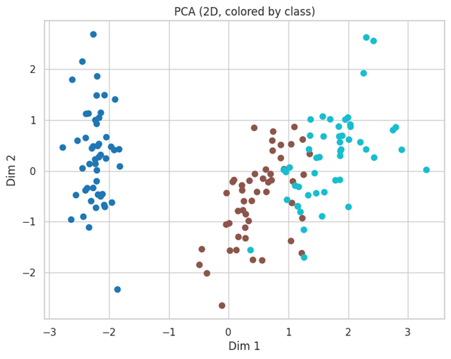  
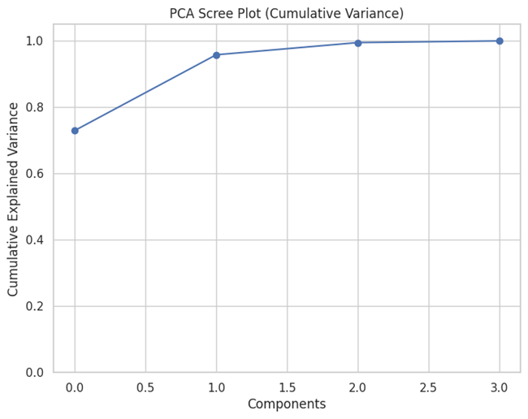  

---

### 🔹 t-SNE
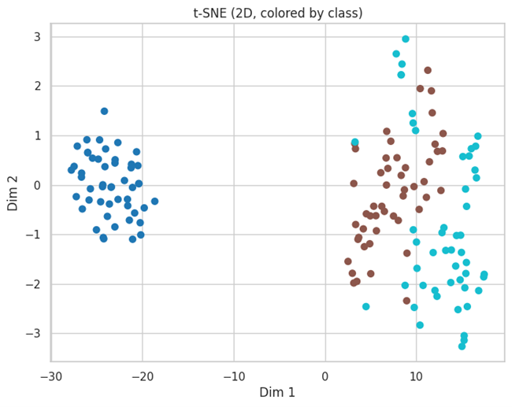  
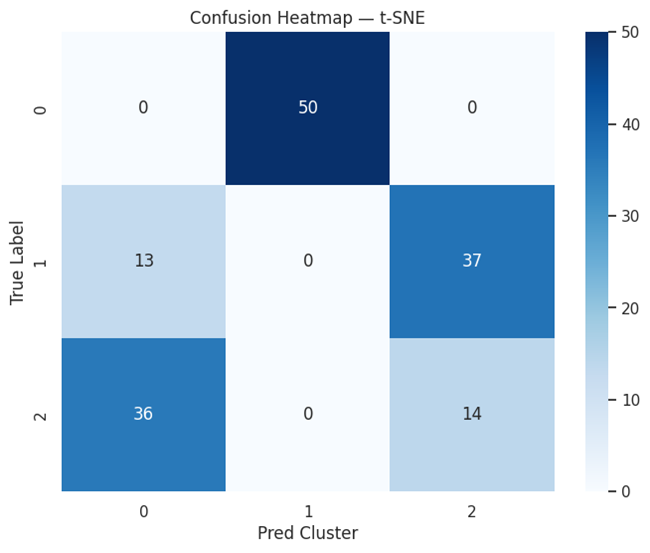

---

### 🔹 UMAP
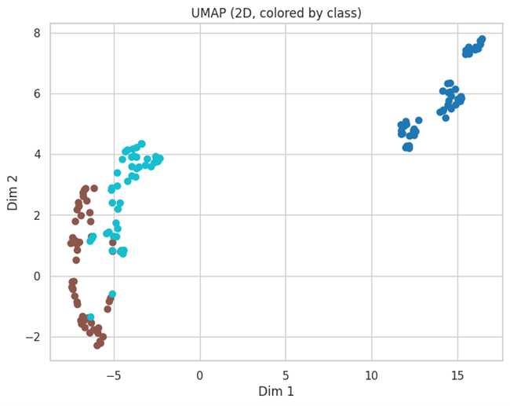  
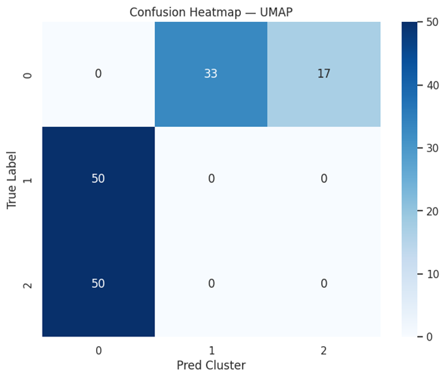

---

### 🔹 Isomap
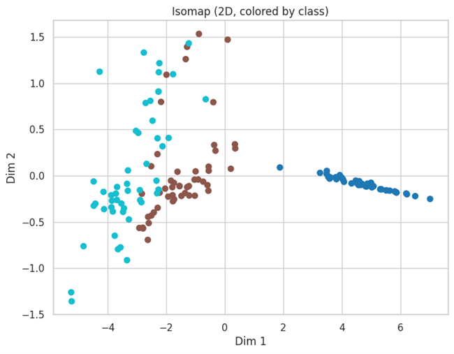

---

### 🔹 Locally Linear Embedding (LLE)
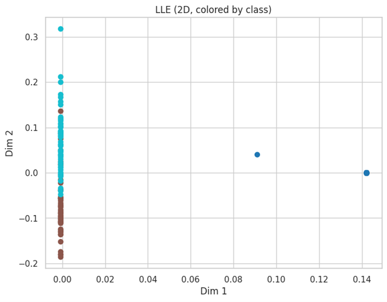

---

### 🔹 MDS
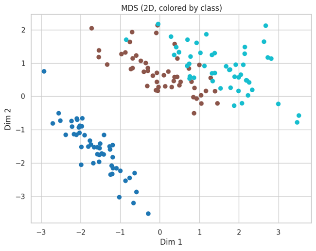  
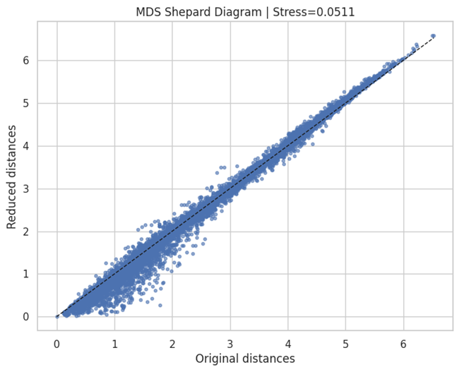

---

### 🔹 Autoencoder (AE)
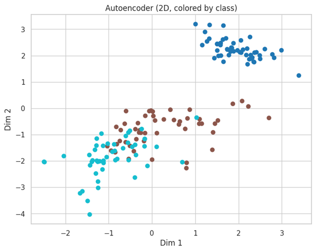  
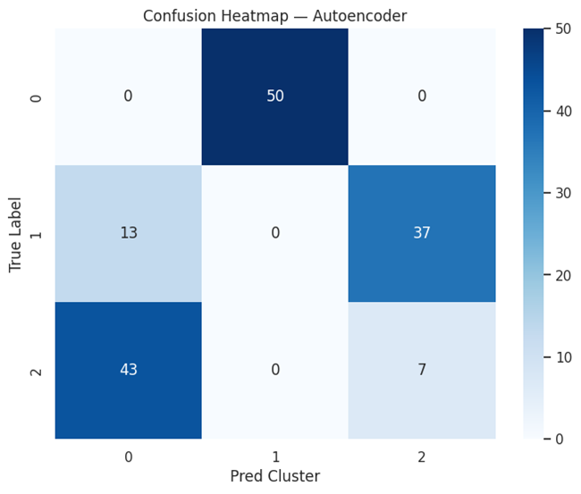

---

### 🔹 Variational Autoencoder (VAE)
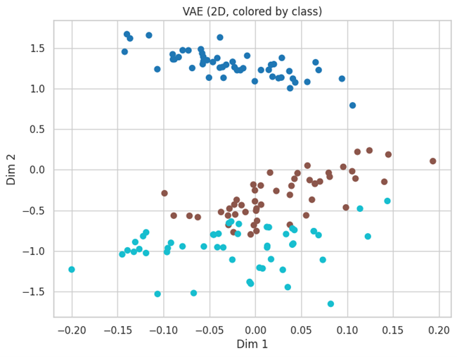  
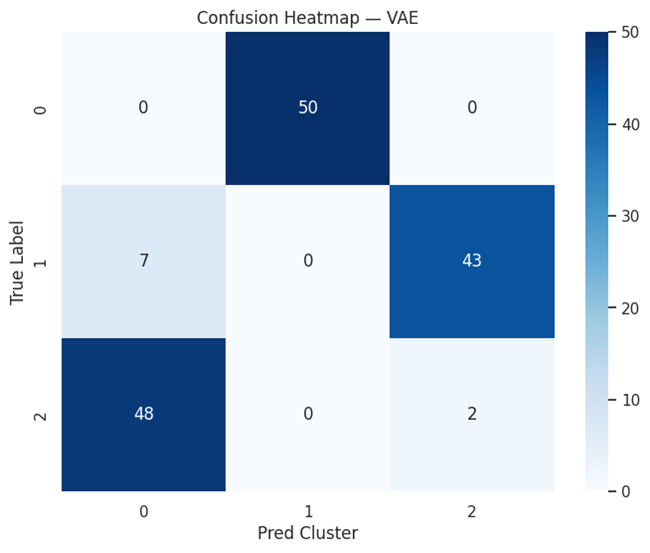

---

### 🔹 Dimensionality Comparison & Evaluation
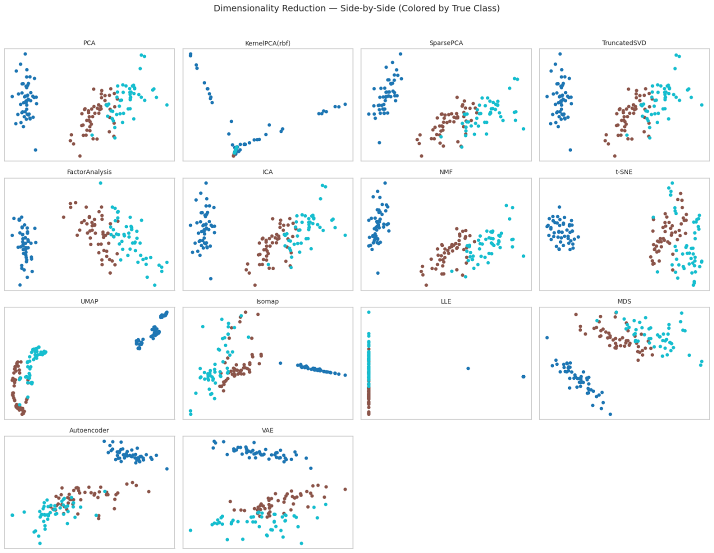  
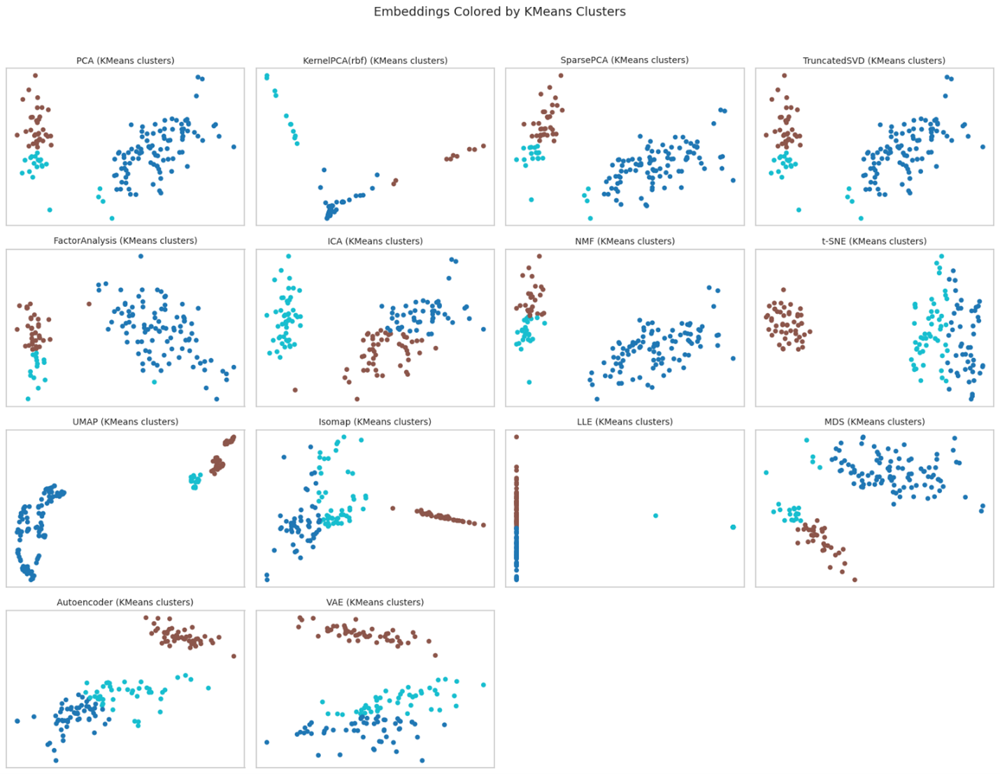  
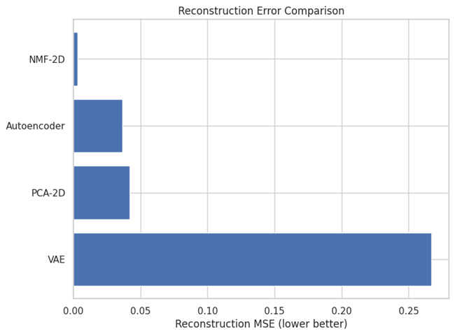  
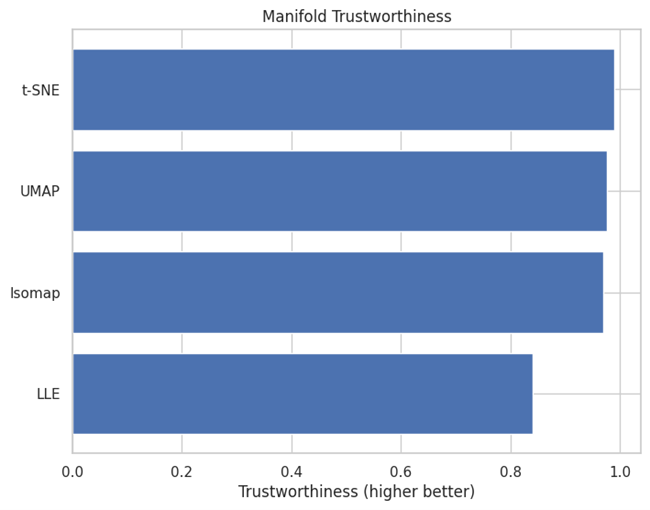

---

## 🧩 Downstream Clustering Results
| Method | Silhouette | ARI | NMI |
|--------|------------:|----:|----:|
| VAE | 0.650 | 0.834 | 0.824 |
| LLE | 0.726 | 0.756 | 0.754 |
| Autoencoder | 0.535 | 0.676 | 0.700 |
| Isomap | 0.569 | 0.664 | 0.688 |
| t-SNE | 0.648 | 0.600 | 0.646 |
| ICA | 0.479 | 0.571 | 0.610 |
| UMAP | 0.773 | 0.453 | 0.653 |
| Factor Analysis | 0.418 | 0.452 | 0.605 |
| NMF | 0.531 | 0.440 | 0.648 |
| Sparse PCA | 0.525 | 0.433 | 0.590 |
| Truncated SVD | 0.523 | 0.433 | 0.590 |
| PCA | 0.523 | 0.433 | 0.590 |
| MDS | 0.505 | 0.433 | 0.590 |
| Kernel PCA (RBF) | 0.883 | 0.057 | 0.213 |

---

## 🔬 Insights
- **VAE** achieves the best external clustering alignment (highest ARI/NMI).  
- **UMAP** and **LLE** provide highly separable manifolds with top silhouette scores.  
- **Autoencoders** balance geometric structure and reconstruction fidelity.  
- **Kernel PCA (RBF)** performs poorly due to over-smoothing at γ = 15.  
- Linear methods (PCA, SVD, FA) perform reliably but lack non-linear boundary capture.

---

## 🔮 Future Enhancements
- Integrate **Diffusion Maps** and **Hessian LLE** for deeper manifold exploration  
- Add **dynamic visualization (Plotly Dash)**  
- Extend to **high-dimensional real-world datasets (MNIST, CIFAR)**  
- Compare **training efficiency (runtime, memory)** for each method  

---

## 👨‍💻 Author
**Shubham Singh**

---

## 📜 License
MIT License

